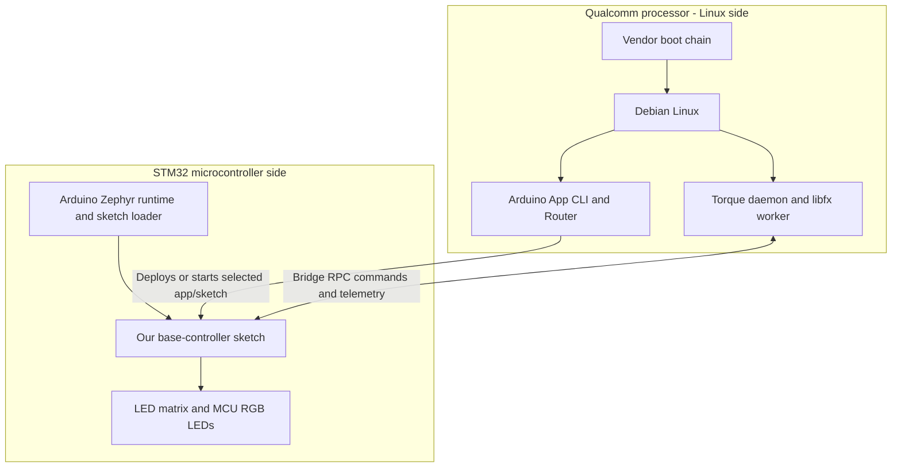
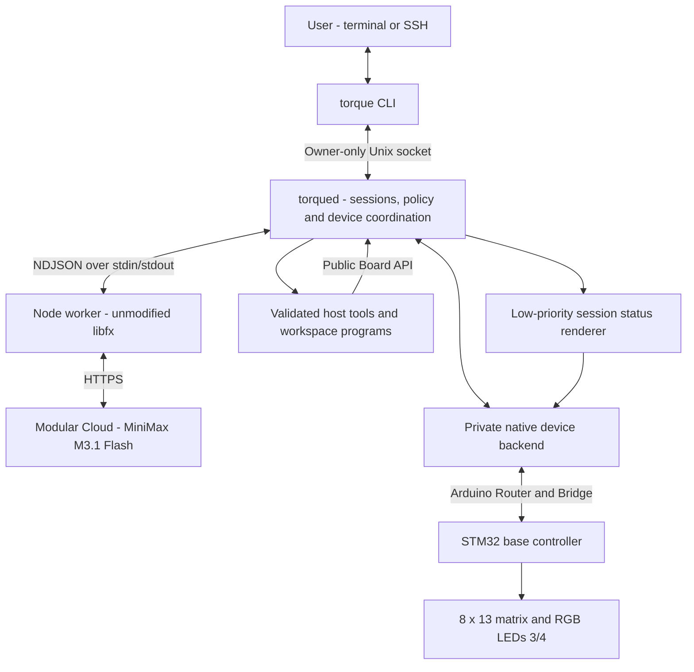
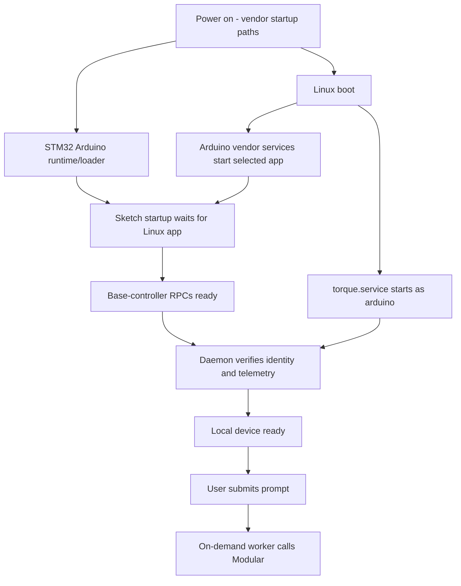

# Torque architecture

Torque runs an agent harness on the UNO Q's Linux processor and controls board
outputs through an application sketch on its STM32. Modular performs model
inference in the cloud. This document describes the implemented boundaries;
[design specs](docs/design-spec/) describe extensions and open decisions.

## Installed system versus source checkout

Board checks and update acceptance on 2026-10-26 Pacific time established:

| Component | Installed/observed state |
|---|---|
| Torque Linux application | Version 0.2.0, update protocol 1; unattended activation and no-op/repeat checks verified. Query `torque status --json` for the selected release ID. |
| Agent engine | Unmodified native `libfx@0.0.14`, private Node runtime |
| Active cloud model | `MiniMaxAI/MiniMax-M3.1-Flash` through Modular |
| MCU controller | Base controller **0.4.0 / protocol 1.3**, boot ID `1203245458` unchanged across migration/update |
| Update authority | Application releases/current owned by `arduino`; only exact Torque restart is delegated; service/launcher/policy remain root-owned |
| Arduino Zephyr core | **1.0.0** |
| Deployed sketch FQBN | `arduino:zephyr:unoq:wait_linux_boot=app` |
| Effective link mode | `dynamic`, inherited from the installed core |
| Selected startup app | `/var/lib/torque/device/uno-q/controller` |
| Linux kernel | `7.0.0-g122c2c22d838` |

The matched **controller/SDK 0.4.0 / protocol 1.3** bundle is deployed, with nine
volatile MCU preset slots for single-command selection. Model/reset, revised
Ctrl-C behavior, project input, the example catalog and the unattended updater
are installed. Subsequent Linux changes use `torque update` without another
firmware upload. See the
[resident preset design](docs/design-spec/2026-10-24-resident-animation-presets.md) and the
[controller guide](firmware/uno-q/controller/README.md) and
[grayscale design](docs/design-spec/2026-10-24-matrix-grayscale.md).

## The firmware and software layers

There is no single “boot firmware” containing the whole product. The Linux
processor has a vendor boot chain; the STM32 has Arduino's runtime/sketch loader.
Our controller is an application on the MCU, and Torque is an application on Linux.

| Layer | Maintainer | Responsibility |
|---|---|---|
| Board/Linux boot chain | Board vendors / Arduino | Hardware initialization and Linux startup |
| Debian kernel, drivers and services | OS / Arduino | Processes, networking, Bluetooth, display drivers and Arduino host services |
| STM32 Zephyr runtime and sketch loader | Arduino Zephyr core | Resident RTOS, drivers, Arduino APIs and sketch loading/startup |
| Base-controller sketch | Torque | Matrix/RGB commands, animation buffers, validation and telemetry |
| Linux agent harness | Torque | Terminal UI, model interaction, tool policy, session/device ownership and feedback |

Arduino's Zephyr loader is more than a traditional tiny bootloader: the core
builds a sketch ELF which its precompiled Zephyr firmware dynamically loads.
Our deployed build uses that dynamic mode. We have not customized the vendor
boot chain or Arduino loader; the standard uploader may refresh the official
loader when it detects a core-version mismatch. The
[pinned Arduino core explanation](https://github.com/arduino/ArduinoCore-zephyr/blob/1.0.0/README.md#-under-the-hood)
describes the loader/sketch relationship and update behavior.



The STM32 runtime has its own startup path. With `wait_linux_boot=app`, sketch
startup waits for the Linux application rather than simply running immediately.
Arduino App CLI starts the selected controller app; its small Python deployment
wrapper runs `App.run()`. That wrapper is separate from the agent and from user
programs. `torqued` checks the actual controller identity/capabilities before
advertising device readiness.

Starting another Arduino app/sketch can replace the MCU application our daemon
expects. Stopping a Linux wrapper alone does not prove an autonomous MCU loop
stopped. Diagnose identity/readiness rather than automatically flashing a sketch.

## Runtime components and communication

For everyday commands and examples, see the [Torque command reference](docs/cli.md).



- **`torque`** is our terminal frontend. It sends prompts, displays replies and
  pending approvals, and provides attach/cancel/status/device/program commands.
- **`torqued`** runs as the normal board user. It supervises the worker, validates
  and authorizes host effects, maintains the private event stream and coordinates
  hardware access. It is the persistent local service.
- **libfx** supplies the model loop, conversation history and tool-call sequencing.
  The worker starts on demand and exits after 30 idle seconds. It refreshes
  instructions/skills between turns. Standalone stock `fx` remains separate.
- **Public Python SDK** programs use `from torque import Board, Frame` and talk
  through the daemon. `unoq_control` is the private native backend and explicit
  bring-up/diagnostic API.
- **Base controller** exposes bounded RPCs for matrix/RGB control and state.
  Installed 0.3.0 supports binary/eight-level grayscale and up to 32 buffered frames.
  The daemon owns the one MCU telemetry subscription and fans it out to readers.

An SSH disconnect detaches the view while accepted work can continue. Attach
does not resend a prompt. A daemon restart reports an interrupted turn; it does
not blindly replay shell effects. Conversation persistence belongs to libfx's
store; live frontend output is a bounded stream with explicit gap reporting.

The updated frontend uses Ctrl-C to stop active work, reset managed outputs to
standby and return to chat. `torque cancel` remains cancellation-only.
Model selection and hardware reset are direct daemon control requests, with no
model interpretation. Selection preserves history and applies on the next turn;
reset additionally restores managed matrix/RGB state. See the
[command reference](docs/cli.md) and
[control implementation journal](docs/journal/2026-10-25-model-reset-and-cancellation.md).

## Requests, authorization and output lifetime

Users describe outcomes. Ordinary board commands use typed tools such as
`matrix_fill`, `matrix_clear`, `matrix_draw` and `rgb_set`. They do not require
generating Python projects or inspecting installed SDK internals. Requested
programs use bounded file tools and the managed `run_program` runner.

| Policy | Behavior |
|---|---|
| `auto` (default) | Validated board actions, bounded reads, project writes and workspace Python execution proceed automatically; advanced shell commands ask |
| `ask` | Effects require one-time approval for the exact request/session |
| `full` | Explicit turn/session choice without human prompts; validation, device ownership and OS permissions still apply |

Auto policy is authorization by tool category, not an OS sandbox. Programs retain
the normal account's OS access. Firmware/service maintenance and unrelated
changes are not routine program prerequisites. libfx instrumentation observes
execution; Torque's host tools make authorization decisions. Model credentials
are not exported to tool subprocesses and remain outside settings/projects.

Explicit user display state takes priority over session feedback:

1. Direct fill/draw/clear commands retain their framebuffer after the tool and
   turn finish. An explicit off command retains a blank matrix.
2. A user program acquires temporary ownership on its first write, replacing any
   retained scene. A competing writer is rejected. Status resumes when that
   program releases/disconnects.
3. `matrix_release` explicitly returns the display to session cues. Normal standby
   loops Heart Pulse; working loops the gallery's Half Helix. The MCU
   plays cached clips, and foreground ownership invalidates the status cache.
   Explicit reset leaves a steady standby dot with playback stopped. See the
   [status animation design](docs/design-spec/2026-10-25-status-animations.md).
4. A daemon restart adopts saved output only if MCU boot ID and framebuffer
   still match and playback is stopped. It does not replay the write onto a new
   MCU boot or overwrite an independently changed frame.

Controller 0.2.0 has no output-expiry watchdog. A frozen cue after a crash is not
proof that the daemon is alive. Matrix evidence comes from the firmware
framebuffer; RGB readback comes from GPIO, neither from an optical sensor.

## Boot and deployment



The daemon makes no inference request just because Linux booted. Local device
readiness does not prove cloud authentication/network health. Status is shown
when no user scene/program owns the matrix.

`setup.sh` has staging and privileged fresh-install phases. The latter initially
installs a root-owned bundle, selects/deploys the stable controller app and enables
the normal-user service. The explicit unattended-update bootstrap then makes
application releases user-owned and delegates only Torque restart. It preserves
the root-owned launcher/unit, `NoNewPrivileges` and Arduino boot default. Ordinary
usage and configured Linux updates need no password or environment activation.
Full installation/reboot tests remain separate from routine Linux deployment.

Arduino App CLI may compile/load/upload when starting its selected app, including
at boot. A normal Torque prompt or Python pattern change sends RPC commands to
the running sketch and does not upload firmware. The Arduino core may update its
official loader when required; loader updates and our application changes are
distinct responsibilities.

| Change | Relevant layer |
|---|---|
| Light LEDs, change a pattern, run supported animations | RPC commands to the running MCU sketch |
| Agent tools/policy, CLI or session UI | Torque Linux runtime release |
| New low-level MCU capability | Controller sketch plus matching SDK/runtime release, deliberately deployed |
| Arduino core/loader ABI change | Official MCU runtime/toolchain; rebuild and validate the matching sketch |
| Keychron session bindings | Linux input/session adapter; capture is a separate manual tool today |
| Proposed DSI screen, kernel panel driver or device tree | Linux/Qualcomm display path; [panel compatibility is experimental](docs/journal/2026-10-24-compact-dsi-display.md) |
| Full Linux image/boot recovery | Separate board provisioning/recovery operation |

## Installed paths and user ownership

| Location | Purpose |
|---|---|
| `/opt/torque/`, `/opt/torque/releases/<release>/` | Application parents and releases owned by the runtime account after bootstrap; initial unbootstrapped setup is root-owned |
| `/opt/torque/current` | Runtime-account-owned selected release symlink after bootstrap |
| `/usr/local/bin/torque`, `/etc/systemd/system/torque.service` | Root-owned launcher and normal-user system service |
| `/etc/sudoers.d/torque-runtime-restart`, `/etc/torque-runtime-updates.json` | Root-owned exact restart rule and bootstrap completion record |
| `~/torque/AGENTS.md`, `~/torque/projects/`, `~/torque/skills/` | User instructions, programs and custom skills, preserved across runtime updates |
| `~/.config/torque/settings.json` | Model, workspace and runtime paths |
| `~/.config/torque/credentials/modular-api-key` | Separate owner-only credential file, mode 600 |
| `/var/lib/torque/` | Session store, metadata, saved display intent and installation records |
| `/var/lib/torque/updates/` | Private transactions, admission/resource leases and recovery state |
| `/var/lib/torque-runtime-bootstrap.json` | Root-owned administrator migration journal |
| `/var/lib/torque/device/uno-q/controller/` | Stable deployed Arduino app directory, independent of release/project names |
| `/run/torque/control.sock` | Owner-only local IPC socket, mode 600 |

The source checkout, managed release and user workspace are separate. Packaged
skills come from the selected release; custom skills come from the workspace.
An update must not overwrite user instructions/projects or silently deploy a new
sketch. The old `~/projects` prototype directory is not a runtime dependency.

## Source structure

Application activation is coordinated by `torque.update` outside the service.
`torque.runtime` provides persistent update records, exclusive deployment locking,
and inherited program/resource leases. The daemon admits one update only while
idle and keeps a persistent maintenance fence across restart. Application paths
are pinned to a resolved release for each process. A separate stdlib administrator
bootstrap delegates only the exact service restart; ordinary update code never
runs as root. See the [update design](docs/design-spec/2026-10-25-unattended-runtime-updates.md).

```text
torque/
  ARCHITECTURE.md                  Implemented system boundaries
  apps/cli/                       Thin CLI entry point
  services/torqued/                Thin service entry point
  packages/session/src/torque/     CLI, daemon, policy, IPC, public SDK, coordinator
  engines/fx/                     Pinned libfx worker and engine proof
  packages/device/                Private native transport, frames and telemetry
  firmware/uno-q/controller/       MCU application and Arduino deployment wrapper
  agent/                          Packaged instructions, skills and references
  assets/                         Static waiting/error/reset cues
  templates/workspace/             Seeded user instructions
  config/                         Model IDs and capability metadata
  install/                        Staging, system install and explicit verifiers
  scripts/                        Developer diagnostics and build helpers
  examples/                       Reference programs; newer-source features noted
  tools/session-studio/            Offline layout/event simulator
  tools/keychron-capture/          Manual Linux input survey
  tests/                          Unit, wire, C++ and behavior checks
  docs/                           Design proposals, journals and evidence
  projects/                       Ignored development output
```

## Evidence and planned extensions

- [Runtime and hardware validation record](docs/torque-runtime.md).
- [Fresh-install E2E](docs/fresh-install-e2e.md): actual installation and Linux reboot.
- [Plain-language control journal](docs/journal/2026-10-24-natural-language-control-and-approvals.md): automatic control, permission denial and restart counter 45 → 45.
- [Base-controller guide](firmware/uno-q/controller/README.md): exact source/installed version boundary.
- [Torque vision](docs/design-spec/2026-10-24-torque-vision.md): broader future scope.
- [Native FX runtime option](docs/journal/2026-10-24-native-fx-runtime-option.md): resource observations and acceptance gates for a possible future Node-free adapter; no migration selected.

Session Studio is currently offline, not the deployed renderer. Keychron capture
does not dispatch Torque commands or run as a persistent service. Live Studio
composition, physical harness controls, fonts, display watchdog,
TFT/DSI integration, home/GitHub adapters, firmware rollback and full uninstall
have their own design/integration milestones. Linux runtime rollback/recovery
is implemented by the unattended updater.
