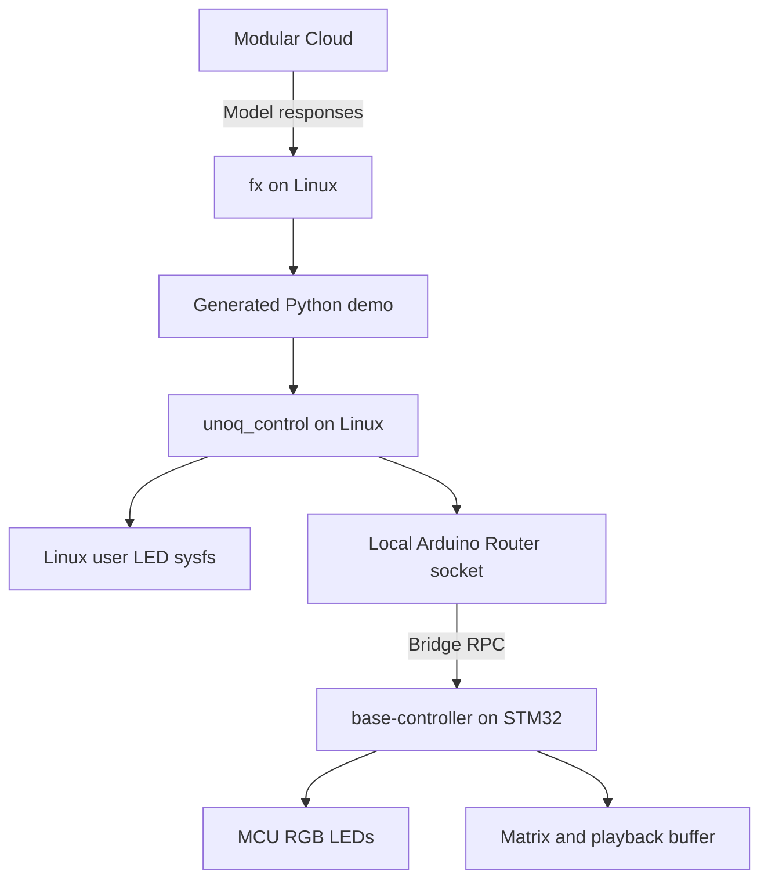

# UNO Q base controller firmware and Python control

**Status:** Version 0.2.0 is deployed and verified, 2026-10-24.
GPIO/framebuffer state, asynchronous delivery, and recovery across an MCU firmware
restart pass live checks. See the
[controller guide](../../firmware/uno-q/controller/README.md) for actual commands.

## Purpose

Use one shared MCU firmware, named `base-controller`, for common UNO Q demos.
Upload it once, then let Python on Linux change LED colors, matrix images, and
buffered animations through Arduino Bridge. fx generates Python programs that
use this interface. A new picture or animation should not require a new sketch.

Firmware changes remain necessary when adding an MCU driver or command, fixing
firmware, or changing the protocol. This is a small, extensible controller; it
does not attempt to preload every possible Arduino library.

The initial release covers onboard LEDs and the matrix. GPIO and attached
devices can follow after the onboard control path is reliable.

## Hardware ownership and scope

| Component | Owner | Controller scope |
|---|---|---|
| User RGB LED 1 | Linux MPU | Python uses the existing `red:user`, `green:user`, and `blue:user` sysfs channels |
| Status RGB LED 2 | Linux MPU | Leave system status triggers under Linux control |
| RGB LEDs 3 and 4 | STM32 MCU | Expose individual color channels; hide active-low wiring from Python |
| Blue LED matrix | STM32 MCU | Draw and clear monochrome frames, then add buffered playback |
| Green power LED | Power rail | No software command |

The matrix has **8 rows × 13 columns = 104 pixels**. The two MCU RGB LEDs are
active-low. These ownership boundaries come from the
[UNO Q manual, UI and Indicators](https://docs.arduino.cc/resources/datasheets/ABX00162-ABX00173-datasheet.pdf).
The driver uses the installed core's `LED3_R/G/B` and `LED4_R/G/B` definitions,
confirmed in its UNO Q variant header and compiled with the pinned profile.

Later extensions may expose selected header GPIO, PWM, analog inputs, and I2C
devices. Each needs a pin allowlist, resource ownership, and electrical limits.
Do not expose boot, reset, console, Bridge, or matrix pins as generic GPIO.
External buttons, sensors, motors, cameras, and audio hardware need their own
drivers and hardware setup; they are outside the first release.

## Runtime architecture



Reuse Arduino Bridge's existing MessagePack RPC transport instead of inventing
a serial framing protocol. The MCU library uses the board's routed UART; the
Python library connects through Arduino Router.
[MCU Bridge library](https://github.com/arduino-libraries/Arduino_RouterBridge),
[Python Bridge library](https://github.com/arduino/arduino-router-bridge-py).

Prefer a native Linux Python client using `arduino.router_bridge`, connected to
the existing local Unix socket. Provision its dependencies in a project virtual
environment. Users should not need to install uv manually. The existing fx
installer and Linux RGB demo retain their standard-library-only Python path.

The native client and installed router must first pass an on-board compatibility
check. The initial SSH user lacked socket access. After the user joined the
existing router group, a fresh SSH session reached the router and correctly
reported the absent controller RPC. The implementation does not change socket
permissions or group membership automatically.
The App Lab wrapper deploys the sketch, while separate native Python clients
send commands. Restarting the app for each pattern would defeat the purpose.
Do not make App Lab restart or `arduino-app-cli app start` the normal drawing
operation. `arduino.app_utils` is confined to the managed deployment wrapper.

Arduino CLI remains a preparation and firmware deployment tool. Once the
controller is running, normal control should need only Python, the existing
router, and the resident firmware. Verify that path on the connected UNO Q
before treating it as supported. Preserve existing services and boot defaults.

The MCU control interface does not need a Modular API key. The key remains in
fx's separate private credential file.

## Repository structure

```text
firmware/base-controller/
  app.yaml                   App CLI deployment wrapper
  python/main.py             App Lab runtime, independent of native demos
  sketch/
    sketch.ino               Startup and main loop
    sketch.yaml              Pinned core and library profile
    src/controller.*         Frame buffers, upload state, playback
    src/protocol.*           RPC registration, MCU LED and matrix drivers
    src/telemetry*           Snapshots, event encoding, and bounded publisher
python/
  pyproject.toml             unoq_control and pinned native dependencies
  src/unoq_control/          Board, Frame, LEDs, CLI, and validation
examples/
  01-linux-rgb-led/          Direct Linux LED demo
  02-mcu-rgb-led/            Python MCU RGB demo
  03-matrix-patterns/        Python frame drawing
  04-matrix-animation/       Buffered finite playback
  05-state-observer/         Passive state/event observation
  idle-sketch/              Deliberate replacement firmware
scripts/
  prepare-controller.py     Native client installation and compile only
  flash-controller.py       Explicit deployment and identity verification
projects/                   User-generated demos, ignored by Git
```

Keep model setup and project skills in their existing locations. There is one
shared firmware source; retired standalone apps are removed rather than archived.
The deployed App Lab wrapper does not run each user demo. Native demos connect
to the existing router independently.

## Python interface and RPC contract

Expose an ergonomic Python interface over versioned RPC names beginning with
`unoq.control.v1.`. The namespace avoids collisions with unrelated Bridge
methods. The table defines the logical contract. Version 0.2.0 wire types,
application errors, and accepted limits are specified in the controller guide.

| Python operation | RPC suffix | Behavior |
|---|---|---|
| `board.info()` | `system.info` | Firmware identity, protocol major/minor version, and a per-boot identifier |
| `board.capability(name)` | `system.capability` | Supported feature and its limits; query capabilities individually to bound replies |
| `board.rgb(3).set(r, g, b)` | `rgb.set` | Set MCU LED 3 or 4 using three booleans; PWM dimming is a later capability |
| `board.matrix.draw(frame)` | `matrix.draw` | Validate and display one frame, stopping current playback |
| `board.matrix.clear()` | `matrix.clear` | Stop playback and blank the matrix |
| `board.matrix.stop()` | `matrix.stop` | Stop playback and hold the current frame |
| `board.matrix.status()` | `matrix.status` | Report playback state and the last committed upload identifier |
| `board.matrix.load(frames, durations)` | `matrix.begin`, `matrix.write_frame`, `matrix.commit` | Upload into staging storage and atomically replace the stored animation |
| `board.matrix.play(repeat=1)` | `matrix.play` | Start the committed animation with an explicit repeat count |

`board.rgb("linux-user")` uses sysfs, not an MCU RPC. It should reuse the current
Linux demo's brightness and trigger snapshot/restore behavior.

On connection, the client checks firmware identity, protocol major version, and
requested capabilities before issuing control commands. A different sketch or
unsupported major version produces an actionable error. Minor versions may add
optional capabilities without breaking existing commands. Connecting and asking
for information must not change LEDs or start playback.

Use calls with responses for control, rather than fire-and-forget notifications.
Return explicit success or a stable application error. Distinguish invalid
arguments, unsupported capability, busy, stale upload, and insufficient buffer
space from transport timeout, disconnected router, and absent RPC method.

### Frames and buffered playback

A logical frame contains exactly 104 integer values, each 0 or 1, indexed as
`pixels[row * 13 + column]`. Validate dimensions, values, and types on both sides.
Reject the entire frame before changing displayed state. Confirm orientation
physically with an asymmetric test pattern.

Version 0.2.0 packs a frame into 13 bytes and transfers it as 26 hexadecimal
characters, with the first pixel in the first byte’s most significant bit.
The public Python API still accepts 104 integers or eight rows. All mutation
requests also carry the expected boot identifier. Wire tests include the full
MessagePack envelope and maximum-size numeric arguments within a 256-byte budget.
RPC boundary strings use Arduino `String` in the pinned stack.

Version 0.2.0 accepts **32 frames** and durations of **20..60,000 ms**. Packed
active/staging pixel buffers consume 832 bytes; their 32-bit duration arrays add
256 bytes, before bookkeeping and the unpacked driver frame. These are accepted
input limits, not measured physical timing guarantees. Capabilities report them.

`begin` creates one bounded upload with an identifier. Each `write_frame` checks
the identifier, index, pixels, and duration. Duplicate writes replace the same
staging slot. `commit` requires every frame and swaps storage only after all
validation succeeds. The old display and animation remain usable during an
incomplete upload; a failed or expired upload never becomes active. An MCU reset
invalidates upload identifiers and stored frames.

A successful commit stops previous playback and holds the visible frame until
an explicit `play`, `draw`, or `clear`. Repeating the last successful commit
returns its previous result without restarting playback. A status query resolves
an ambiguous commit timeout.

Playback runs from MCU memory with a nonblocking timer. Python does not send a
command for every displayed frame. Default to one finite playback; infinite
repeat requires an explicit request. Advertise accepted input bounds separately
from measured scheduler and driver performance. Do not promise a frame rate yet.

### Serialization and lifecycle

One main-loop execution path owns matrix rendering, playback, and state changes.
Version 0.2.0 uses `Bridge.provide_safe`, available in the installed pinned
release; successful compilation is separate from live callback verification.
The Bridge library documents separate callback-thread and main-loop-safe modes.
[MCU callback execution](https://github.com/arduino-libraries/Arduino_RouterBridge#the-bridge-object).
Avoid long sleeps, unbounded queues, or nested outbound RPC calls in handlers.

The Python client serializes writes and takes an advisory local lock while
controlling the MCU. This coordinates cooperating demos; it is not authentication
and does not prevent other router clients from issuing commands.

At boot, blank the matrix, turn MCU RGB LEDs off, discard uploads, and establish
a new boot identifier. On ordinary Python disconnect, retain the last image and
let a requested finite animation finish. Closing a client does not implicitly
clear another program's display. Demos should explicitly clear or restore their
own state when appropriate. Reset or power loss clears volatile animation data.

Use bounded connection and call timeouts. Recheck identity after reconnect and
surface a changed boot identifier to the caller. Retry read-only queries within
a bounded policy; do not blindly replay `play` or other state transitions after
an ambiguous timeout. Use upload identifiers to make transfer retries safe.
Explicitly close a failed connection attempt to stop background reconnect work.

## Preparation and firmware deployment

Keep three operations distinct:

1. **Prepare:** inspect board identity and tool versions, fetch explicitly
   requested dependencies, and compile. Cache downloads and build artifacts on
   disk. This does not upload firmware or preload a compiler into RAM.
2. **Deploy:** show the selected firmware and current app, explain that the MCU
   sketch will be replaced, and perform the requested upload. Record source
   revision, dependency versions, artifact hash, and any available previous app
   or artifact needed for restoration. Verify the controller identity afterward.
3. **Control:** run Python demos against the installed controller. Do not build,
   upload, restart apps, change services, or alter boot defaults in this path.

Start from the existing `arduino:zephyr:unoq` profile: core 1.0.0 and RouterBridge
0.4.1, with the other dependencies pinned in the
[base controller profile](../../firmware/uno-q/controller/sketch/sketch.yaml).
Revalidate the combined firmware rather than assuming separate successful
compilations prove it works. Dependency updates should be deliberate.

The main `setup.sh` continues to configure fx without flashing. A later explicit
controller preparation option may install the native client and cache build
dependencies. No generated Python demo should install tools or deploy firmware
automatically when it finds a missing controller.

Document how starting another Arduino app can replace the resident firmware.
After a board reboot, check controller identity again; do not promise that it
survives every existing App Lab startup configuration. Missing firmware should
produce instructions, not an automatic upload.

## Migration of the examples

The shared-controller implementation replaces the earlier standalone MCU apps:

| Earlier example | Current example |
|---|---|
| Linux RGB LED | `examples/01-linux-rgb-led` keeps its standalone standard-library path |
| MCU blink | `examples/02-mcu-rgb-led` sends RGB commands from Python |
| Matrix sweep | `examples/04-matrix-animation` uploads a buffered sweep |
| Bridge LED control | Its transport becomes the shared client; `examples/03-matrix-patterns` demonstrates frame updates |

Retired standalone app copies are removed. No archive directory is maintained.
The optional [idle sketch](../../examples/idle-sketch/) remains available for
intentional replacement. A controller `clear` command stops its own playback;
it cannot stop a different autonomous sketch.

Skills now generate Python clients by default. New firmware is needed only for
unsupported capabilities or firmware changes. The
[empty fx tool arguments issue](../journal/2026-10-23-fx-empty-shell-arguments.md)
remains separate. Preserve stock fx and its permission checks.

## Implementation stages and acceptance

| Stage | Deliverable | Acceptance |
|---|---|---|
| 1 | Native client and transport prototype | Verify installed socket access, callback mode, argument/return encoding, payload limits, and reconnect behavior; pin the Python dependency |
| 2 | Identity, MCU RGB, matrix draw and clear | Compile, deliberately upload once, then run two different Python patterns without rebuilding, uploading, or restarting the app |
| 3 | Buffered animation | Upload frames, start finite playback, and confirm playback completes after the Python process exits |
| 4 | Examples, skills, and migration | New demos use the public client; retired standalone apps are removed; setup still does not flash |

Test frame validation, index mapping, buffer limits, incomplete uploads, duplicate
writes, state transitions, and protocol compatibility without hardware. Use a
fake transport to test timeouts and error translation. Add hardware tests as
explicit opt-in checks, with upload separated from read-only diagnostics.

On the UNO Q, verify bad input leaves the display unchanged, a different sketch
is detected, an MCU reset invalidates stale uploads, and two cooperating Python
processes cannot interleave a transaction. Record successful compilation,
successful upload, and a person's physical LED observations separately.

Measure warm and cold build time, deployment time, command round-trip latency,
and buffered playback timing separately. Report median and tail latency for
commands; an RPC acknowledgment alone does not measure the visible LED change.
The expected improvement is removing compilation and upload from pattern edits.
Numeric latency and frame-rate commitments follow the first board benchmark.

## Related work

The [matrix graphics design](2026-10-24-matrix-graphics-and-fonts.md) adds Python
pixel authoring, bitmap fonts, and text/animation generation above this existing
frame API. Long marquees use streaming rather than exceeding the 32-frame buffer.

The [controller telemetry design](2026-10-24-controller-telemetry.md) extends the
controller with read-only snapshots, independent GPIO readback, asynchronous
state events, and a live SDK/CLI observer. It supplies an event source for later
fx reactions without changing the existing output-control API.

The [fx hardware feedback design](2026-10-24-fx-hardware-feedback.md) uses this
controller for configurable agent status displays. It proposes an optional
expiring display lease for feedback output, with ownership tokens so a stale
client cannot clear another owner's display. That extension must be specified
and tested before enabling unattended repeating feedback animations. Ordinary
demo playback retains the lifecycle behavior defined above.

This generalizes the earlier
[Bridge matrix journal proposal](../journal/2026-10-23-bridge-matrix.md).
The [validation results](../validation.md) separate historical app builds, current
controller software/live checks, and remaining power-cycle and optical timing checks.
