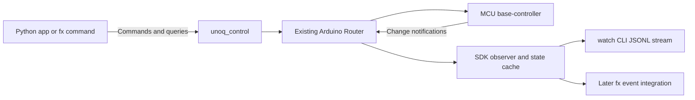

# UNO Q controller state and asynchronous telemetry

**Status:** Implemented and verified end to end, 2026-10-24. Extends the deployed
[base controller](2026-10-24-base-controller.md). Firmware/SDK 0.2.0 and
protocol 1.1, preserving the existing version 1 command namespace.

## Purpose and scope

Give Python and fx a reliable view of current component state and changes.
Version 0.1.0 acknowledges commands and reports matrix playback status. Add
coherent snapshots, GPIO readback, asynchronous events, and a live observer so
debugging does not depend on inferring state from command logs.

Implement the MCU-to-Python telemetry path now. Later fx integration can consume
the events to update its UI or trigger explicitly configured actions. This
release does not modify fx or automatically turn hardware events into model
prompts or shell commands.

## State sources

| Component | Requested state | Reported state and source |
|---|---|---|
| MCU RGB LEDs 3 and 4 | Last accepted RGB booleans | Independently read GPIO levels, converted through active-low wiring; `gpio_readback` |
| Matrix | Frame and animation commands | Current firmware framebuffer, playback cursor/state, committed and staging upload IDs; `firmware_framebuffer` |
| Controller | Accepted/rejected commands | Boot identity, uptime, revision, last command/result, subscription and queue counters |

RGB remains binary per channel. Brightness or PWM duty-cycle fields belong only
to a driver that advertises dimming support. Matrix data remains 104 monochrome
pixels with the existing packed encoding.

GPIO readback establishes pin levels; the framebuffer establishes the image the
firmware is rendering. Actual emitted light and optical brightness still need
a person, camera, or sensor. Never label cached requested values as independent
hardware observations.
If GPIO readback fails, report it as unavailable with invalid quality rather than
inventing an off state. Use raw GPIO levels before applying active-low conversion.

## Architecture

Use existing Bridge RPC and notifications with the local socket trust boundary.
The Python notification callback only enqueues messages and never makes nested
Bridge calls. A separate worker renews subscriptions, reconciles state, and
publishes normalized events.

MCU main-loop-safe handlers and the render loop capture state. A bounded queue
passes copied events to a dedicated publisher thread. Enqueueing never waits for
Linux. Shared UART traffic still adds contention; measure its effect rather
than promising zero impact on command latency.

## Snapshot and health APIs

| Python operation | Purpose |
|---|---|
| `board.snapshot()` | Coherent state of both RGB LEDs and matrix |
| `board.rgb(3).status()` | Requested channels, GPIO readback, and source labels |
| `board.matrix.frame()` | Current framebuffer as a `Frame`, through a snapshot |
| `board.health()` | Uptime, last command/result, subscription and queue counters |
| `board.watch()` | Context-managed event iterator with a latest-state cache |

Add wire methods under `unoq.control.v1.system`: `snapshot`, `health`,
`subscribe`, `renew`, and `unsubscribe`. Existing commands and `matrix.status`
remain compatible. Advertise the optional `telemetry` capability; old firmware
continues to support its original API without telemetry.

Collect each snapshot in one MCU main-loop callback, reading GPIO levels and
the current packed framebuffer together. Python expands compact wire fields
into readable names, booleans, source labels, and timestamps.

Snapshots, health replies, and events must fit the installed 256-byte RPC budget,
including the MessagePack envelope and callback method name. Use compact,
versioned JSON strings at Arduino RPC boundaries and the existing 26-character
frame encoding. Test maximum numeric values and complete packet lengths.

The implementation uses compact snapshot fields on the wire; SDK and CLI
consumers receive expanded names:

| Wire field | Meaning |
|---|---|
| `v`, `b` | Telemetry schema and MCU boot identifier |
| `s`, `r`, `t`, `c` | Event sequence, revision, wrapping MCU milliseconds, command counter |
| `rgb` | Two `[requested_mask, raw_gpio_mask]` pairs for LEDs 3 and 4; raw -1 means unavailable |
| `f`, `p`, `i`, `n` | Packed frame hex, playing flag, playhead index, stored frame count |
| `a`, `u` | Committed animation and pending upload identifiers |

Notifications carry one compact JSON string argument. They add `h` for the
subscription token, `k` for component/error kind, and `o` for cause. RGB events
use `q`/`g` masks; matrix events reuse frame/playback fields; errors use `e`/`z`
for code and operation. Callback names are `unoq.telemetry.v1.` followed by
sixteen lowercase hexadecimal characters. Repeating subscribe with the same
callback endpoint returns its existing token.

## Events and reconciliation

Normalized events carry schema version, event kind, boot identity, wrapping
32-bit event sequence and state revision, MCU timestamp, and component data.
Kinds include snapshot, RGB, matrix, error, gap, reconnect, and disconnected.
Source labels identify GPIO readback versus firmware framebuffer data.

Include a controller command counter and cause such as command, playback, or
readback change. Error events contain bounded codes rather than arbitrary input.
Read-only queries do not generate events merely because they were queried.
Periodically sample GPIO to detect changes independent of commands.

Sample matrix progress every 200 ms by default and coalesce intermediate frame
changes. RGB changes and errors are queued promptly. Event sequence counts
published events; state revision can advance between sampled events. Intentional
sampling must not look like packet loss.

Use an eight-entry MCU queue. On overflow, retain recent state and increment a
drop counter; event sequence gaps expose omissions. Bound receiver queues too.
On a gap or local overflow, fetch a fresh snapshot and emit a resync event.
Ignore stale-boot, stale-token, and superseded-revision events instead of
rewinding the current state cache.
This is state telemetry, not a durable journal of every transient edge. Consumers
must also process snapshots; a future button/input edge API may need stronger
delivery and retention semantics than display-state sampling.

## Subscription lifecycle

Start with one MCU observer, advertised by capability. A future Linux coordinator
can fan this stream out to multiple fx sessions. Other clients can still read
snapshots and control outputs while observation is active.

Register a unique router callback endpoint, then subscribe using it. Restrict
endpoint format and length to the telemetry namespace. The MCU returns an opaque
token tied to its boot. Renew outside callbacks approximately every three seconds
with a ten-second lease. A second observer receives busy rather than stealing
the active slot.

Close unsubscribes only the matching token and disconnects its callback
connection. Expiry releases the slot. Observation never takes the SDK's output
writer lock. **Observer expiry does not alter LEDs or playback.** This is separate
from the future display ownership lease in the
[hardware feedback proposal](2026-10-24-fx-hardware-feedback.md).

On connection loss or a changed MCU boot, mark state stale, reconnect with bounded
retries, establish a new subscription, and fetch a new snapshot. Recovery must
not replay actuator commands. The SDK owns a separate observation connection and
cleans it up on context exit or parent close.

The implementation defaults to three reconnect attempts, configurable up to 100.
A deliberate firmware-update test used 60 attempts to span compilation and MCU
downtime. The observer detected the new boot, resubscribed, refreshed its cache,
and received a fresh GPIO event. A separate old-boot command was rejected by
the restarted MCU.

## CLI and future fx integration

Add `unoq-control snapshot`, `health`, and `watch`. Snapshot and health are
read-only. Watch supports a bounded duration and JSONL output for scripts, with
explicit gaps and reconnects. Normal output should make component states easy
to inspect without exposing compact wire field names.

Future fx integration consumes the stream locally. Agent status feedback and
device telemetry remain distinct event kinds. Command/cause metadata helps
suppress reactions to the agent's own output. High-frequency events must not
become individual model turns by default.

## Implementation and acceptance

1. Add MCU snapshots, GPIO sampling, health counters, and capability metadata.
2. Add the bounded publisher and subscription lifecycle.
3. Add SDK decoding, observation/reconciliation, and CLI commands.
4. Compile and test with simulated transports before updating the controller.
5. Deploy and verify the complete path on the UNO Q.

Host tests cover codec limits, active-low conversion, field validation, sequence
wrap/gaps, stale events, queue overflow/resync, cleanup, and observation without
output mutation. Native simulation uses the actual Bridge package.

Live tests compare RGB commands against GPIO readback and known matrix frames
against snapshot data. Observe async events while a second client changes outputs.
Test observer exclusion, close/reopen, expiry/stale tokens, transport reconnect,
and boot changes during an approved firmware replacement. Queries must remain
available during observation, and subscription failure must not break commands.

Measure packet sizes, event latency, queue drops, and command latency with and
without observation. A final checked fx request reads a snapshot. Keep software
assertions, GPIO/framebuffer readback, and optical confirmation separate in the
validation record.

Implementation and live results are recorded in
[validation](../validation.md#controller-telemetry-on-2026-10-24). Run
`python/.venv/bin/python scripts/verify-controller.py` for read-only checks or
add `--exercise-outputs` for the repeatable RGB/matrix telemetry test suite.
