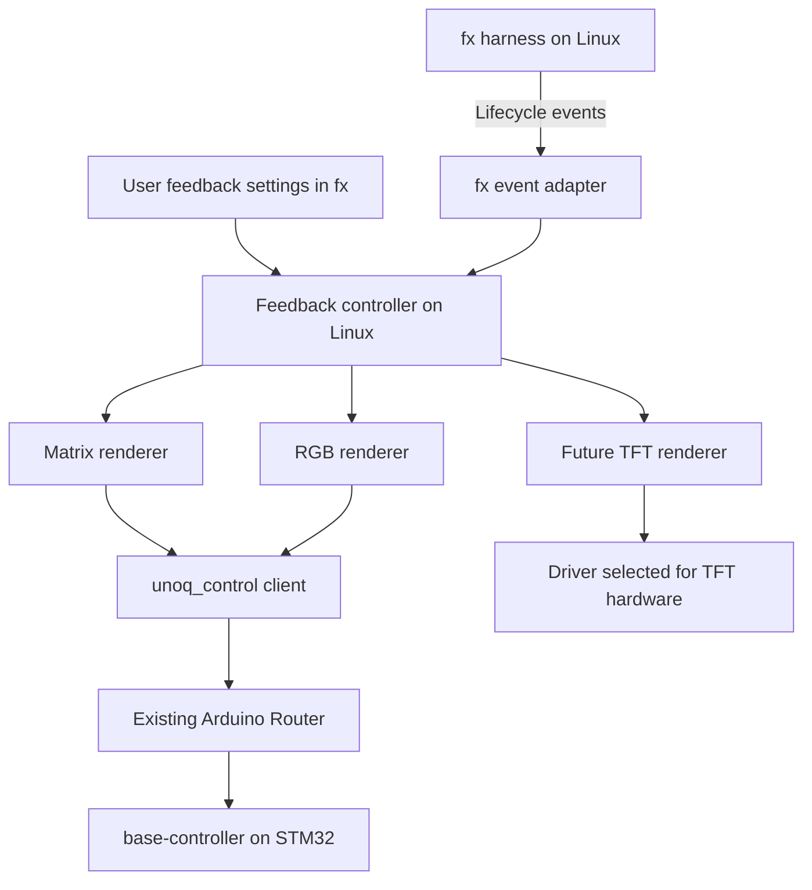

# Configurable hardware feedback for fx on UNO Q

**Status:** Draft for review, 2026-10-24. Builds on the
[base controller design](2026-10-24-base-controller.md).

## Vision and first release

Make the UNO Q a physical interface for fx. When the harness receives a prompt,
waits for a model, receives output, runs a tool, or needs user input, connected
devices reflect that state. Users configure what appears, which device shows
it, and how it looks from within fx.

Start with status icons and animations on the onboard matrix. Add RGB feedback
and future TFT renderers through the same event interface. A TFT could show a
tool name, elapsed time, selected model, or optionally response text. Select its
hardware and wiring separately; a TFT driver might belong on Linux or the MCU.

The first release provides a matrix theme, state selection, enable/disable
controls, and reliable recovery from disconnects. Rich text, user-authored
themes, and additional display hardware follow after the status path works.
This draft does not deploy firmware, change the installed fx, or enable feedback.

## Architecture



There are three responsibilities:

1. **fx exports execution facts and preferences.** It does not drive pixels or
   call Arduino CLI during a turn.
2. **The feedback controller derives display state and renders it.** A small
   Linux companion process owns themes, output routing, and device coordination.
3. **The base controller executes bounded hardware commands.** It draws frames,
   plays buffered animations, and handles output expiry without knowing about
   models, prompts, or tools.

The display follows harness events automatically. It does not depend on the
model remembering to call an LED tool, and status changes make no additional
inference requests. Explicit creative tasks, such as drawing a heart, still use
the normal Python control interface.

## fx integration and the soft fork boundary

Current libfx documents instrumentation hooks for turn, model, tool, permission,
and actual user-wait boundaries. Content capture defaults to off. These hooks
are a useful event vocabulary, but their availability in the installed native
interactive CLI must be verified separately.
[fx instrumentation API](https://fx.sh/docs/lib/api#instrumentation).

Prefer a supported native event export if it covers the required states.
Otherwise maintain a small soft fork with two additions: a local event exporter
and feedback configuration/status controls. Keep Arduino dependencies, themes,
and device drivers outside fx's core. Avoid requiring a new JavaScript runtime
solely to connect the existing native CLI to the hardware.

Pin the upstream revision and isolate patches so that upstream releases remain
easy to review and merge. Keep the custom build distinguishable from stock fx;
installation and upgrade paths must select it explicitly. Preserve provider
behavior and permission checks. The
[earlier malformed tool calls](../journal/2026-10-23-fx-empty-shell-arguments.md)
remain a separate compatibility issue.

## Events and display state

The [controller telemetry contract](2026-10-24-controller-telemetry.md) supplies
the reverse path: reported component state and async changes. Keep these device
events separate from fx lifecycle events. A future reaction policy can consume
them deliberately, using cause/command metadata to avoid feedback loops. The
telemetry implementation does not automatically start model turns.

Use a versioned local event envelope containing a session identifier, execution
identifier, sequence number, timestamp, event type, and minimal state metadata.
The adapter normalizes upstream events into this contract. Device renderers
should not depend directly on changing fx internals.

| Harness activity | Display state | Initial matrix theme |
|---|---|---|
| Session ready for a prompt | `ready` | Small steady dot |
| Prompt accepted | `starting` | Brief acknowledgment flash |
| Foreground model request awaiting output | `model_wait` | Pulse |
| Foreground model producing output | `responding` | Moving wave |
| One or more tools executing | `tool_running` | Spinner |
| Harness waiting for a user's answer or approval | `waiting_for_user` | Question mark |
| Turn completed successfully | `completed` | Brief check mark, then ready |
| Turn failed | `failed` | Cross, then retain the last outcome in diagnostics |
| Turn cancelled | `cancelled` | Brief stop symbol, then ready |
| Event source lost or device reconnecting | `offline` | Distinct disconnected pattern when reachable |

An in-progress model call is not evidence about its internal reasoning. Likewise,
automatic permission evaluation is not necessarily a request for user input.
Use actual wait boundaries to show the question mark. Typing indicators would
need terminal input integration and are outside the first release.

Track active tools and waits by identifier. Ending one tool must not show idle
while another is still running. Ignore background title generation when deriving
the foreground state. A tool failure can produce a brief error indication while
the turn continues; only a failed turn produces the terminal `failed` state.

Within a selected session, use this precedence: disconnected or unknown state,
waiting for user input, running tools, response activity, waiting for model,
then ready. Completion, failure, and cancellation badges have bounded durations.
Starting a new turn supersedes an old badge immediately.

Select one foreground session by default. Do not interleave two sessions' icons
on the same matrix. Later aggregate views may show child agents or session
counts on larger displays.

## User configuration in fx

Provide an fx settings view to choose outputs, enable or disable feedback,
select a theme, choose displayed states, and preview a pattern. Also show whether
the controller is connected, which firmware is running, and why an output is
unavailable. Preview deliberately uses the selected device; opening settings
alone does not take over the display.

The following is a **proposed integration schema**, not a setting supported by
the current stock CLI:

```json
{
  "hardware_feedback": {
    "version": 1,
    "enabled": true,
    "session": "foreground",
    "content": "status-only",
    "outputs": [
      {
        "id": "unoq-matrix",
        "device": "unoq.matrix",
        "theme": "minimal",
        "show": ["status", "completion", "errors"],
        "states": {
          "model_wait": "pulse",
          "responding": "wave",
          "tool_running": "spinner",
          "waiting_for_user": "question",
          "completed": "check",
          "failed": "cross"
        }
      }
    ]
  }
}
```

Store the preferences in user-owned fx configuration through the custom
integration's schema. The Linux companion receives a validated configuration
snapshot. Do not add these fields to today's installer until that integration
exists. Keep configuration free of device code and shell commands.
Per-state mappings override the selected theme; omitted states use its defaults.
Validate state names and asset identifiers before activating a configuration.

Global user preferences are the default. Named profiles can later provide quiet,
minimal, or detailed output and optional workspace-specific choices. A workspace
must not silently enable additional content display. Disabling feedback releases
its display ownership and leaves fx fully usable.

Each renderer declares its capabilities. The monochrome matrix supports icons
and small animations; a supported RGB LED adds color; a TFT may support text and
layout. Reject unsupported settings with a useful explanation. Do not pretend
the matrix supports color or send full paragraphs to its 104 pixels.

Status-only is the initial content policy. Tool names, model names, elapsed time,
and response text are separate opt-ins as their renderers become available.
Prompts, tool arguments, tool results, and raw model output are unnecessary for
basic status feedback and stay outside that event path. API keys remain in the
existing private credential file, not in feedback configuration or device data.

## Runtime behavior and display ownership

Use a local Unix socket with access limited to the current user for communication
between fx and the companion. Launch the companion on demand when feedback is
enabled; do not add a boot service or network listener as a setup side effect.
Support multiple fx processes through one cooperating coordinator per user.

The event exporter must not block the agent on a device operation. Use bounded
queues, coalesce redundant activity, and retain the latest state snapshot.
Reconnect with a snapshot or mark the state unknown when it cannot be recovered;
do not reconstruct authoritative state by parsing terminal text or guessing
from old session files.

For the first release, upload the new state's short animation on a state
transition and play it from MCU memory, subject to firmware buffer limits.
Preloading an entire theme and selecting among clips would require a future
named-clip or range-play capability beyond the base spec's single animation.
Rate-limit richer display updates and avoid sending a new MCU frame for every
model token. Measure added process memory, event processing cost, and
state-to-display latency on the 4 GB board.

Feedback and user demos share the same matrix. Put their ownership coordination
in the common `unoq_control` path: feedback has low priority, and an explicit demo
can acquire the device and pause feedback. On release, restore the latest agent
status rather than replaying queued old animations. This is coordination among
cooperating clients, not a security boundary against arbitrary Bridge callers.

Use an **expiring feedback display lease** so that a crashed companion cannot
leave an endless busy animation. fx liveness updates let the companion detect a
lost session; MCU lease expiry also covers failure of the companion itself.
Choose timeout values during board validation and publish them as configuration
limits. On expiry, stop feedback playback and blank the matrix. Renew or clear
only the matching lease token so a stale client cannot erase a new owner's work.

This lease is an extension to the base controller proposal. Ordinary demo
`draw` and `play` operations keep their documented retain/finish behavior.
Feedback's blank-on-expiry policy applies only to leased feedback output.

Hardware connection errors produce an fx diagnostic and bounded reconnect
attempts; they do not fail or retry model work. Unsupported firmware produces
setup instructions. Normal feedback must not compile, flash, restart an app,
change services, or relax permissions to recover.

## Proposed repository additions

Keep the MCU implementation and `unoq_control` client in the locations defined
by the base controller spec. Add the feedback components alongside them:

```text
python/src/unoq_feedback/
  events.py                 Versioned event contract and validation
  state.py                  Session state reduction and precedence
  config.py                 Preferences and capability validation
  coordinator.py            Local connection, ownership, and liveness
  renderers/
    matrix.py               Themes through unoq_control
    linux_rgb.py            Later RGB feedback
    tft.py                  Later hardware-specific renderer
assets/feedback/matrix/     Declarative frames for built-in themes
config/feedback.example.json
integrations/fx/
  README.md                 Supported event source and integration workflow
  upstream.json             Pinned revision if a soft fork is required
  patches/                  Focused patches if required, without vendoring fx
tests/feedback/             State, routing, ownership, and renderer tests
```

These are proposed paths. Any actual fork can live in its own repository; this
workspace should record how the integration is built and selected.

## Implementation stages and acceptance

| Stage | Deliverable | Acceptance |
|---|---|---|
| 1 | Verify the native fx event surface | Observe model, tool, real user-wait, cancellation, and turn-outcome events on the target version; decide supported export versus a focused fork |
| 2 | Controller with a simulated display | Replay event fixtures, validate preferences, and prove state reduction for concurrent tools, missing events, and reconnects |
| 3 | Matrix feedback with one theme | Use the base controller, buffered patterns, ownership coordination, and lease expiry; deliberately deploy required firmware once |
| 4 | Configure from fx | Enable/disable, choose states and theme, preview output, and show device diagnostics without editing JSON manually |
| 5 | Additional outputs | Add RGB and a chosen TFT driver through renderer capabilities without changing the harness event contract |

The first physical milestone is a full turn that shows model activity, a running
tool, and completion. Add a turn that genuinely waits for user input and a
cancelled turn. A person confirms that the patterns are distinguishable on the
matrix; software acknowledgments alone do not establish that.

Test event bursts, overlapping tools, nonterminal tool errors, two fx sessions,
device disconnect, firmware reset, fx exit, and a killed companion. Verify that
the display lease expires, a user demo can take over, and stale releases cannot
clear another owner. With the device missing or feedback disabled, fx must still
finish its turn normally. Basic feedback must work without extra cloud requests
or capture of conversation content.

Report build/upload checks, physical observations, memory use, and measured
latency separately. Keep these results distinct from the existing
[stock fx validation](../validation.md).
