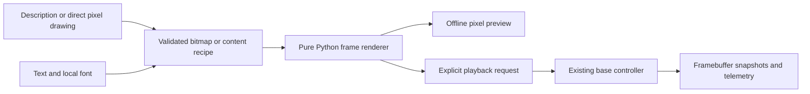

# Matrix pixel art fonts and animations

**Status:** On hold, 2026-10-24. Onboarding and boot readiness take priority.
This draft extends the deployed controller/SDK 0.2.0.
The APIs and commands below are proposals, not implemented features.

## Purpose and scope

Let users describe an icon, draw directly on a pixel grid, display text, and
create simple animations through fx. The agent produces editable pixel assets
and Python programs that reuse the existing base controller.

Keep the first implementation entirely in Python's standard library. Work with
binary pixels and predefined bitmap glyphs. Do not add image processing, photo
imports, resizing/thresholding pipelines, Pillow, OpenCV, or an image-generation
service. The agent draws by generating pixel rows or simple drawing commands.

The first complete example is a finite right-to-left marquee of **Modular**,
with a local preview, observable playback, and a clear matrix afterward.

## User workflows

| Input | Agent or editor produces | Example |
|---|---|---|
| Plain-language description | A small bitmap or explicit animation frames | Draw a tiny rocket with blinking exhaust |
| Direct drawing | Binary cells on a 13-column by 8-row grid | Paint a heart, erase a pixel, duplicate a frame |
| Text | Glyph layout and scrolling frames | Scroll Modular from right to left |
| Existing pixel asset | An edited bitmap or clip | Make this robot wink three times |

An agent-generated drawing should be a deliberate simplification for 104 pixels.
Prefer a readable silhouette and a few distinct poses. Save the result so the
user can adjust pixels or timing without regenerating the entire program.

The authoring flow is:



Creating an asset or preview does not start hardware playback. A request to
create and show/run it authorizes ordinary playback through the current SDK;
it does not require another confirmation for every frame or a firmware upload.

## Display and pixel model

The target is **13 columns × 8 rows**, monochrome blue. In the current protocol,
each pixel is 0 or 1. An “8-bit” visual style can mean chunky pixel art, but the
actual matrix frame is **1-bit**, not 256 intensity levels.

Keep the existing `Frame` as the hardware boundary: exactly 104 row-major integer
pixels, or eight strings of thirteen pixels through `Frame.from_rows`. Origin
is the logical upper left, x increases right, and y increases downward. Lit
pixels are `#` or 1; off pixels are `.` or 0. The existing frame codec owns the
26-character wire encoding.

A small `Bitmap` helper can hold wider text strips or smaller sprites before
cropping a viewport into a `Frame`. It needs only binary row data and simple
operations such as setting a pixel, cropping, and placing another bitmap.
Keep bounds and placement explicit. A 13×8 asset becomes a frame directly.

## Font choice

Bundle two small, local font choices rather than asking the agent to invent
letter shapes for every program:

| Font identifier | Metrics | Intended use |
|---|---|---|
| `classic5x8` | Five data columns, eight available rows, six-pixel advance | Recommended compact default for readable marquee text |
| `font8x8-basic` | Eight-column by eight-row cells, eight-pixel advance | Wider retro-style lettering and compatibility with the suggested font collection |

The Adafruit classic font is commonly called 5×7, but its renderer reads all
eight bits of each column. Preserve the eighth row for characters with descenders
rather than cropping it. Its implementation uses five data columns plus a
spacing column. [Font data](https://github.com/adafruit/Adafruit-GFX-Library/blob/master/glcdfont.c),
[renderer](https://github.com/adafruit/Adafruit-GFX-Library/blob/master/Adafruit_GFX.cpp).

The suggested `dhepper/font8x8` collection fits the matrix's eight-row height and
declares its font data public domain. Its glyphs are eight row bytes, with the
least-significant bit at the left. Normalize that orientation before using
`Frame`; do not copy those bytes directly into the controller's flattened
most-significant-bit-first frame encoding.
[Encoding and provenance](https://github.com/dhepper/font8x8/blob/master/README).

Initially support printable ASCII, including mixed-case Modular. Report an
unsupported character clearly or use an explicitly selected `?` fallback. Emoji
and custom symbols should be supplied as pixel assets rather than silently
substituted with blank glyphs.

Convert selected upstream glyph data into a small validated JSON font asset at
development time. Runtime font loading reads that data, not C headers or Python
code. Each font records its source revision/hash, license, dimensions, advances,
and glyph rows. Retain upstream notices with bundled/adapted data, including the
[Adafruit license](https://github.com/adafruit/Adafruit-GFX-Library/blob/master/license.txt).
No network font downloads are needed during normal use.

### Logical font comparison

These are the first 13 columns of Modular at x=0, derived from the current
upstream glyph tables. They are logical previews, not physical LED observations.

Compact `classic5x8`:

```text
#...#........
##.##........
#.#.#..###...
#.#.#.#...#.#
#.#.#.#...#.#
#...#.#...#.#
#...#..###...
.............
```

Retro `font8x8-basic`:

```text
##...##......
###.###......
#######..####
#######.##..#
##.#.##.##..#
##...##.##..#
##...##..####
.............
```

The compact font fits two complete glyph cells across the viewport. Choose the
final default after comparing moving text on the real board, particularly M,
lowercase letters, spacing, and characters with descenders.

## Text layout and marquee behavior

Render text into an eight-row strip, then slide a 13-column viewport across it.
Use whole-pixel steps and preserve glyph baselines. Static text that exceeds the
viewport should require explicit clipping or scrolling rather than silently
showing a truncated word.

For the initial marquee, start with the text's left edge at x=13 and move left
one column per frame until x equals minus the strip width. Both endpoints are
fully blank. With seven characters and no extra trailing spacing:

| Font | Strip width | Frames including blank entry and exit | Nominal duration at 100 ms per frame |
|---|---:|---:|---:|
| `classic5x8`, one column between glyphs | 41 | 55 | 5.5 s |
| `font8x8-basic`, eight-pixel cells | 56 | 70 | 7.0 s |

These are layout calculations, not measured hardware timing. Default to one
finite pass and a nominal 100 ms step. Repetition and leaving a final image
visible must be explicit options.

## Playback and controller capacity

Controller 0.2.0 stores **at most 32 animation frames**. Both Modular marquees
exceed that limit. The first release must account for this instead of passing
the entire sequence to `matrix.load` and hoping it works.

| Playback path | Use | Tradeoff |
|---|---|---|
| Existing MCU buffer | Clips of 1..32 frames | Autonomous timing; finite playback can finish after Python exits |
| Python streaming | Long marquees and generated sequences | Uses existing `matrix.draw`; Python stays running and Linux/RPC timing can add jitter |
| Future queued MCU stream | Long autonomous or continuously supplied content | Requires a separately designed firmware queue/append protocol |

Use Python streaming for Modular in the first release. Pace frames with a
monotonic clock, keep rendering/transmission bounded, and avoid catch-up bursts
after delays. Rendering and previews should be possible before connecting to
the board. Report the selected playback path to the caller.

Do not claim seamless chunked playback using today's `load`/`commit`: commit
stops existing playback and there is no append queue. Increasing the buffer
could help some messages, but it would still impose a finite text-length limit.
Neither change is needed for the first graphics implementation.

## Agent-generated content and editing

Use a versioned, data-only content document with a 13×8 `mono1` target, named
bitmap assets, sequential steps, and a finish policy. Initial step types are:

- A bitmap with a hold duration.
- A clip of explicit bitmap frames and durations, with a finite repeat count.
- Text using a named font, with static placement or a left-scrolling marquee.

A blinking rocket can be two explicit frames. A wink can be two or three poses.
The agent writes these assets and calls the common renderer; it need not invent
a general scene graph or a custom playback engine for every request.

The [session display studio](2026-10-24-session-display-studio.md) already explores
pixel editing and clips. Add a freeform content mode there later, using the full
matrix as a canvas, rather than creating a second unrelated editor. Direct
painting toggles cells; it does not require interpreting an imported drawing.

Keep freeform content documents distinct from session-region layout documents.
Share font assets, canonical frame/clip data, coordinates, and golden rendering
fixtures. Initially the browser can preview/edit frames produced by Python. Any
later browser text renderer must agree with the same font data and fixtures.

## Proposed package and commands

Add a small `unoq_control.graphics` package for bitmaps, font loading/layout, and
frame sequence generation. Keep these functions independent of Bridge. A thin
playback layer uses the existing SDK and its cooperative writer lock.

Proposed interfaces include `Bitmap.from_rows`, `load_font`, `render_text`, and
`marquee_frames`. CLI commands would render a local preview/export or explicitly
play content. For example, these are proposed commands, not current CLI flags:

```bash
unoq-control render content.json --preview preview.svg
unoq-control text Modular --font classic5x8 --scroll-left --step-ms 100 --repeat 1
unoq-control play content.json
```

Preview/export must be read-only with respect to the board. SVG and ASCII
previews can be produced with the standard library. Keep generated assets and
programs under `projects/<name>/`; bundle reusable font data and notices with
the graphics package. Existing setup and fx/provider configuration stay unchanged.

## Lifecycle and validation

Playback uses the current firmware and normal permission checks. It must not
compile, upload, change services, or widen access to display an asset. Explicit
art playback takes the normal output-writer lock; passive telemetry remains
available. Future agent-status feedback must yield through the existing
[ownership design](2026-10-24-fx-hardware-feedback.md).

Normal completion, Ctrl-C, and SIGTERM enter the selected clear/restore path.
A hard kill or lost connection cannot guarantee cleanup; controller 0.2.0 can
hold the last streamed frame. Its observer lease is not an output-expiry lease.

Host checks should cover glyph orientation, eighth-row preservation, spacing,
unsupported characters, clipping, exact frame dimensions, and the 55/70-frame
Modular calculations. Test that long content selects streaming without an
oversized upload and that previewing makes no hardware calls.

For later live acceptance, show asymmetric F/M glyphs, scroll mixed-case Modular,
run an agent-created two-frame sprite, and exercise interruption cleanup. Compare
selected framebuffer snapshots against expected frames and check final clear.
Record a person's confirmation of legibility and direction separately from
firmware readback. No new firmware is required for this first implementation.
