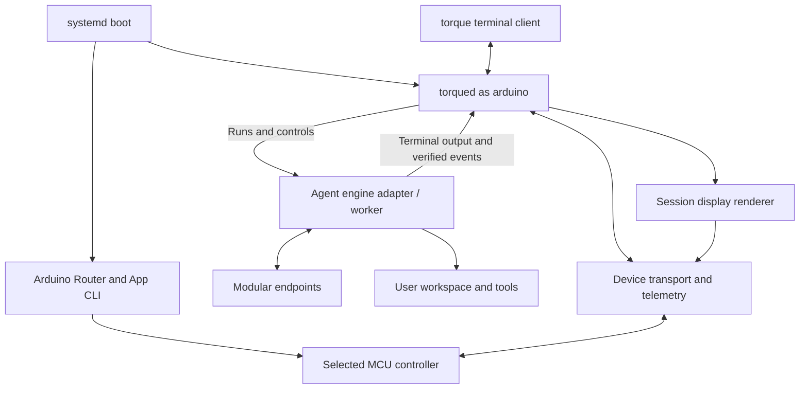

# Torque installation runtime and workspace refactor

**Status:** Initial runtime/onboarding implementation passed fresh-install E2E,
2026-10-24 Pacific time. Real privileged installation, reboot, and pre/post-boot
agent/hardware checks passed. See [runtime implementation](../torque-runtime.md)
and [E2E evidence](../fresh-install-e2e.md). The architecture follows the
[Torque vision](2026-10-24-torque-vision.md); broader display and recovery features
remain separate milestones.

**2026-10-26 follow-up:** This document retains the original onboarding design
and inventory. The [unattended updater](2026-10-25-unattended-runtime-updates.md)
now owns Linux activation/recovery after explicit bootstrap. Application releases
become user-owned; the service, launcher and policy remain root-owned. Grayscale,
resident presets and current status animations are deployed. Use
[current architecture](../../ARCHITECTURE.md) and [CLI usage](../cli.md) for the
installed layout and update procedure.

## Direction

Turn the working prototype into a predictable product installation. A user with
an initialized UNO Q and a Modular key runs setup, reboots when requested, sees
a board-ready indication, opens Torque, and starts programming in a user workspace.

The main decisions are:

- Use **Torque** as the product and command name. Introduce one small background
  service, `torqued`, for local readiness, device coordination, and session state.
- Separate installed application code, user configuration, runtime state, and
  user projects. Updating Torque must not overwrite user programs or custom skills.
- Ship a coordinated runtime, engine adapter, device adapter, and firmware bundle.
  Support the selected bundle rather than a matrix of prototype versions.
- Perform a targeted clean installation and retire the prototype deliberately.
  Do not factory-reset Debian or erase `/home/arduino`.
- Keep graphics, larger animation buffers, grayscale, and the proposed v0.3
  firmware features on hold while onboarding is established.

## Historical onboarding baseline

Read-only inventory on the validation board found:

| Item | Current state |
|---|---|
| Prototype workspace | `/home/arduino/projects/fx-modular-cloud` |
| Controller | Base controller 0.2.0, protocol 1.1, ready and running |
| Startup app | None configured; the controller is not the default app |
| Existing user app | `/home/arduino/projects/matrix_demo`, stopped; preserve it |
| Modular credential | Separate owner-only file under `~/.config/fx/`; value was not inspected |
| fx settings | Owner-only `~/.fx/settings.json`; shared user configuration |
| Proposed visible Torque workspace | `/home/arduino/torque` does not yet exist |

The Mac source checkout has already been renamed to `torque`. That filesystem
rename does not rename the board's running app, installed paths, or GitHub remote.
The remote still uses `tommyjtl/fx-modular-cloud`.

The existing controller, Python SDK, and checked fx/Modular connection remain the
known working baseline. Preserve them until the replacement passes its acceptance
checks. Historical results remain in [validation](../validation.md).

## Installed layout

Use a visible user workspace and a separate managed runtime:

```text
/home/arduino/torque/                 User-owned workspace
  AGENTS.md                          User instructions, seeded once
  skills/                            User-created skills
  projects/                          Generated programs and project repositories

/opt/torque/                          Managed application installation
  releases/<release>/
    bin/                             torque, torqued, pinned engine/worker entrypoints
    runtime/                         Private application environment
    agent/                           Packaged instructions and managed skills
    device/                          Device SDK and transport adapter
    firmware/uno-q/                   Selected controller artifact/source profile
    assets/                          Packaged themes and readiness clips
    release.json                     Component versions, protocols, and hashes
  current -> releases/<release>/

/usr/local/bin/torque                 Entry point into the current release
/etc/systemd/system/torque.service    Boots torqued as the arduino user

/home/arduino/.config/torque/
  settings.json                      Provider/model, workspace, and display choices
  credentials/modular-api-key        Plain key data, mode 600; parent mode 700

/var/lib/torque/                      State writable by the service user
  sessions/                          Session metadata and engine-owned persistence
  device/uno-q/controller/           Stable Arduino App CLI deployment directory
  installed.json                     Installed component and firmware records
  install-manifest.json              Exact Torque-owned paths and setup changes

/var/cache/torque/                    Downloads and build artifacts
/run/torque/control.sock              Private local control/event socket
```

The workspace is user data. The original release tree contained application code
and packaged skills and was root-owned. After unattended bootstrap it is owned
by the runtime account; the running agent is still instructed not to self-update
and retains `NoNewPrivileges`. The configuration
and state directories have their own ownership and retention rules; none belongs
inside a project Git repository.

Load packaged instructions/skills from the selected release and custom skills
from the workspace. Do not duplicate managed source into each generated project.
The engine-adapter proof must establish how both skill scopes are loaded. The
installer seeds `AGENTS.md` only when absent; upgrades preserve user edits.

Keep the deployed Arduino App directory at a stable path. App identifiers and
startup selection must not depend on a user's project name or on the changing
`current` release symlink. User deletion or renaming of a project must not break
the controller's next boot.

## Runtime responsibilities



| Component | Responsibility |
|---|---|
| `torque` | Open or attach to a workspace/session, provide the terminal frontend, expose status/doctor and deliberate maintenance commands |
| `torqued` | Local readiness, one device subscription and state cache, display ownership, session/worker supervision, event/control routing |
| Engine adapter/worker | Model calls, conversation state, tools, permission checks, and supported session controls |
| Device backend | Translate Torque device operations into the selected MCU protocol; normalize reported state |
| MCU controller | Bounded output commands, playback, GPIO/framebuffer state, and device-side lifecycle behavior |
| Renderer | Compose the state/layout selected by the parallel display-interface work |

Start with one foreground session. The daemon does not run model turns merely
because the board booted. Model workers start when requested. A missing display
must not prevent an otherwise healthy agent from working; hardware operations
report their own unavailability.

Use one Torque daemon rather than a separate persistent process per feature.
Keep Arduino Router, App CLI, and their required runtime components as vendor
services. Torque does not replace those services in this refactor.

### Service and local connection

Install `torque.service` as a system service with `User=arduino`, not a root
agent. Arrange the intended router-group access during setup. Use a private
runtime directory/socket accessible to the same user. Service ordering is not
proof of MCU readiness: the daemon still waits for the expected identity and
capabilities. systemd supplies service-user and runtime/state-directory controls.
[systemd execution settings](https://www.freedesktop.org/software/systemd/man/latest/systemd.exec.html).

Use a versioned local request/event protocol. Requests carry IDs, session and
workspace identity, and typed operations. Support replies, current snapshots,
and reconnect cursors/state replacement. Device telemetry and agent lifecycle
events remain separate. Never use terminal text as an authoritative event feed.

### Engine boundary

Keep the engine replaceable. First prove a pinned fx integration on ARM64 with
Modular, the required tools, checked permissions, and the two skill scopes.
The daemon owns session workers so a terminal connection is a view, not the
lifetime of the task. An initial native CLI worker can use a supervised terminal
channel; terminal bytes are forwarded, not parsed into inferred lifecycle events.
Only genuine process/session facts are available until the adapter supplies rich
model/tool/wait events through a verified export, library integration, or focused
fork.

An SSH disconnect detaches the frontend while already authorized work can
continue. Requests for an answer or approval remain pending until a supported
client responds. Reattachment must not resend the prompt or rerun completed
tools. Prove this behavior in the adapter milestone before offering resident
session continuity as a product feature.

libfx documents lifecycle hooks and session controls, but choosing it also means
validating custom-provider support, runtime cost, and host tool/permission behavior.
Instrumentation is observation, not authorization.
[libfx API](https://fx.sh/docs/lib/api#instrumentation).

The adapter must define Torque-owned engine configuration and persistence paths.
Do not fake the account's home directory to isolate a profile: shell, Git, and
device tools need the real user's environment. If the selected native CLI lacks
the necessary configuration or event APIs, resolve that adapter gap before
claiming the integrated harness is ready. Do not silently rewrite unrelated
global fx settings as the long-term solution.

Physical answers/approvals must identify a particular pending request in a
particular session. The daemon cannot bypass execution checks or treat a device
event as blanket approval. Event-triggered model work remains an explicit policy,
not the default behavior of receiving telemetry.

## Boot and first use

1. Linux starts the existing router/App CLI services and `torqued`.
2. App CLI starts the selected Torque controller app at its stable deployment
   path. With this deployment route, startup can invoke Arduino's sketch
   compile/load/upload workflow; it is not triggered by every Torque prompt.
3. `torqued` checks the installed release, local configuration, router access,
   and controller identity/capabilities. It reports starting, ready, or degraded
   states with actionable diagnostics. No inference request is needed at boot.
4. When the local device is ready and no session owns the display, the renderer
   shows a standby cue. This means board/session infrastructure is available,
   not that a model is running or a cloud request has succeeded.
5. The user enters `~/torque` and runs `torque`. The launcher supplies the managed
   Python environment and skills, and selects the user workspace. No manual
   virtual-environment activation or SDK path is needed.
6. The user asks for a supported program. Torque creates it under `projects/`,
   runs it when requested, inspects results, and reports the observed state.

The separate display-interface effort owns the visual pattern and layout. This
refactor supplies readiness/session state and the rendering boundary. Do not
choose a competing animation language or redesign that studio here.

The renderer is low priority. An explicit user program acquires device/display
ownership through the Torque device API; status rendering pauses. On release or
client disconnect, restore the latest applicable status. Do not repeatedly paint
standby over a user's animation, or infer release merely from a blank frame.

The daemon is the public device coordinator and owns the one MCU telemetry slot.
CLI and SDK clients consume its cache/event stream and request writes through
its device API. Keep direct Arduino Router access private to bring-up and explicit
diagnostics. This lets several frontends observe state without competing for
the MCU's single observer slot.

Linux client ownership is not a device-side watchdog. Controller 0.2.0 has an
observer lease, not an expiring output lease. A standby cue must not be sold as
proof that the daemon is still alive after a crash. Reliable dynamic feedback
needs the separately specified output ownership/expiry capability before it
ships; graphics and larger-buffer work remain on hold.

## Installer contract

Keep one user-facing setup entry point, backed by smaller testable operations:

1. Check board identity, disk/network prerequisites, existing installations,
   running apps, and startup selection. Produce a concrete change summary.
2. Obtain the Modular key privately, discover usable model IDs, and choose a
   tested compatible default. Preserve the key outside the workspace and logs.
3. Stage the coordinated release and managed environment. Reuse required vendor
   tools; do not upgrade unrelated board software.
4. Create or reuse the user workspace. Establish intended router access and
   install the normal-user service using the required administrator step.
5. Deliberately install the selected controller and startup-app selection,
   recording the previous app/default. Verify identity before calling it ready.
6. Verify model/tool use and device queries, then perform a requested short visible
   demo. Arrange a final reboot when needed and verify boot readiness afterward.
7. Finish with the workspace path, readiness summary, and the single `torque`
   launch command plus one supported first prompt.

Explain firmware replacement, startup selection, and required account changes
once as concrete setup actions. Rerunning setup must resume or verify completed
steps, not repeat destructive steps or create duplicate hooks/services. A query,
preview, or ordinary launch never authorizes a firmware deployment.

Publication is a separate cutover task: rename the GitHub repository if desired,
confirm the release coordinates, and update bootstrap URLs before advertising
a runnable public command. The existing unpublished bootstrap URL is not a
Torque distribution channel.

## Firmware installation and updates

Firmware is a managed application component, not generated user code. A release
manifest pins runtime/SDK versions, engine revision, accepted MCU protocol and
capabilities, and firmware artifact hashes. Reuse the tested 0.2.0 behavior as
the starting implementation; the public Torque API need not expose its old
package names or wire namespace.

Normal Python changes, text, or agent requests use the loaded controller.
Firmware changes use a deliberate maintenance operation:

1. Stage and verify the candidate bundle/artifact for the UNO Q.
2. Enter maintenance with active work resolved; record the last working bundle,
   controller source/artifact, and startup selection.
3. Update the stable controller deployment directory and deploy through the
   supported Arduino workflow. Stop/wait/start ordering must handle the observed
   App CLI 0.14 restart race.
4. Verify expected firmware family/version, protocol, capabilities, and a fresh
   boot when replacing a reachable controller.
5. Switch the matching runtime release and restart/reconcile the daemon. Test
   local control and readiness before completing the update.

Keep a single known-good rollback bundle. On failure, stop in an explicit
maintenance/degraded state and recover the matched runtime/firmware pair;
do not loop automatic flashes. A daemon readiness failure does not authorize
replacing an unrelated sketch. Starting another Arduino app can replace the
controller; detect that and require deliberate repair.

The initial public matrix format remains binary unless the selected firmware
explicitly advertises another format. The parallel studio's grayscale assets
require a coordinated firmware/SDK extension, not silent conversion or claims
that controller 0.2.0 already supports them.

## Clean cutover and reset boundary

Prefer a targeted fresh Torque installation over resetting the board. Before
cleanup, inventory exact paths and setup changes, preserve user content, and
keep the working prototype until the new installation passes.

| Existing item | Treatment during an approved cutover |
|---|---|
| Prototype base-controller app | Stop/replace deliberately; retain a recovery artifact |
| Prototype source/runtime directory | Retire only after extracting user-created content and validating Torque |
| `projects/` inside the prototype | Preserve/copy user programs into the new workspace; never silently delete |
| `~/projects/matrix_demo`, other Arduino Apps and home files | Preserve in place unless specifically selected for migration/removal |
| Existing Modular key | Explicit private reuse/import or new hidden entry; never print or put in argv |
| `~/.fx` and existing global fx binary | Preserve unrelated settings/history/use; do not remove as a Torque reset |
| Managed shell hooks from the prototype | Remove only exact known managed blocks, after replacement launch works |
| Debian, networking, SSH, vendor services and global caches | Preserve |

Do not add a factory-reset step or a broad deletion of home directories.
An uninstall/reset plan must enumerate only Torque-owned paths and restore
startup selection only when it is still the selection Torque installed.
Runtime replacement/reset retains the user workspace and credentials by default.

Early breaking changes are acceptable: use a new configuration/state schema and
new public commands without old-name aliases, dual protocol servers, or a
general migration engine. For pilot users, provide a short one-time cutover
procedure. Breaking an API is acceptable; discarding user programs or silently
removing credentials is not.

## Proposed source layout

```text
torque/
  apps/cli/                         Terminal entry point
  services/torqued/                  Readiness and local coordination
  engines/fx/                       Pinned engine adapter and any focused patches
  packages/session/                 Normalized state, events, controls
  packages/device/                  Torque device API and private UNO Q transport
  firmware/uno-q/controller/         Managed MCU implementation
  agent/                            Packaged instructions and skills
  assets/                           Themes and status clips
  templates/workspace/              Initial user-owned files
  install/                          Setup, systemd, release/cutover helpers
  tools/session-studio/              Existing parallel design tool
  tests/                            Unit, integration, and opt-in hardware checks
  docs/design-spec/                  Architecture and contract decisions
```

These are target paths, not moves performed by this draft. Preserve the studio's
ongoing work. Source checkout, installed runtime, and user workspace have distinct
roles even when development happens on the board itself.

## Implementation gates and acceptance

1. **Adapter proof:** verify Modular, checked tools, managed/user skills,
   configuration isolation, and honest lifecycle capabilities on ARM64. Choose
   the engine route using that result.
2. **Runtime separation:** install a versioned bundle and user workspace, with
   private local IPC and a normal-user daemon. Workspace edits survive reinstall.
3. **Boot readiness:** configure the selected controller app, reboot, observe
   device-ready state, and open Torque in a fresh SSH session without manual
   activation or build commands.
4. **First program:** use a natural request to create/run a finite matrix demo
   under the user workspace; inspect framebuffer/GPIO state and record a person's
   confirmation separately. No per-project firmware upload occurs.
5. **Integrated session display:** connect genuine lifecycle/wait/outcome events
   to the parallel renderer, with ownership and failure recovery verified.
6. **Maintenance:** exercise a coordinated firmware/runtime update and targeted
   reset/uninstall. Preserve user projects, custom skills, and unrelated services.

Include failures: no network/key, denied router access, stopped/mismatched
controller, daemon restart, terminal disconnect, missing display, and an active
user program. Label unavailable/unknown states accurately. Do not fabricate
working/user-wait events or automatically approve tools to pass a setup test.
