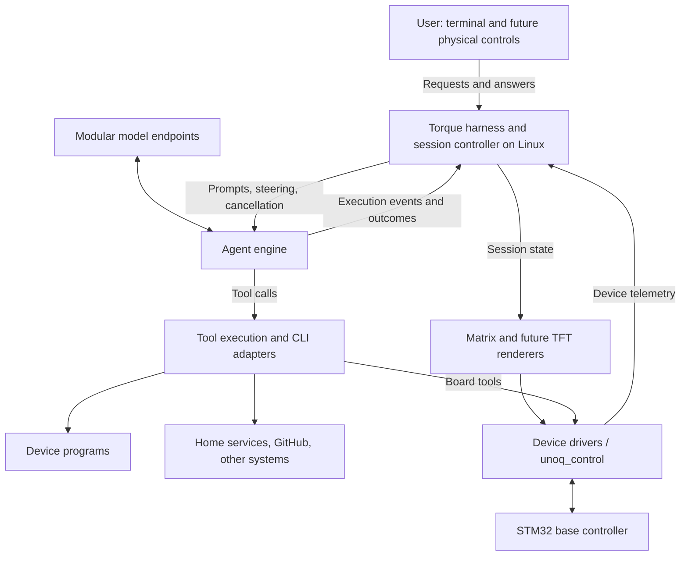

# Torque: project vision and architecture

**Status:** Working vision, 2026-10-24. **Torque** is the working project name.
The [README roadmap](../../README.md#roadmap) records implementation stages.

## What Torque is becoming

Torque is a small, resident agent with reach across the user's systems. It runs
on a programmable device, uses models through Modular's endpoints, and carries
out delegated work through tools and CLIs. Its physical interface makes ongoing
work visible and gives the user a way to interact with it.

The first home is an Arduino UNO Q, with a Qualcomm Linux processor and an STM32
MCU. Cloud inference and local execution are separate responsibilities. The
current implementation runs stock fx on Linux, calls Modular Cloud, and uses
the shared base-controller firmware for board outputs and telemetry.

The wider scope includes programming its own device, operating home services,
and working with GitHub pull requests and other developer workflows. Home and
GitHub are future integration examples; no home platform or PR workflow has
been selected or implemented as a Torque integration yet.

Working description: **a small agent with reach**.

## What we want it to do

| Area | Intended behavior |
|---|---|
| Device software | Generate, run, inspect, and revise programs on its own device; develop new capabilities through tools. |
| External systems | Turn a user request into work through installed CLIs and explicit service adapters, including home and GitHub workflows. |
| Session feedback | Show waiting, model output, tool execution, user waits, outcomes, and connection health through a coherent session model. |
| User control | Accept prompts, answers, approval responses, and cancellation through supported interfaces; add physical controls as hardware is chosen. |
| Extensible outputs | Start with the LED matrix, then add a TFT and other useful outputs without redefining agent lifecycle events. |
| Runtime ownership | Own Torque's application harness, session/controller contracts, tool integration, and physical interface. |

Agent controller means the reach to operate those systems as well as to manage
its own execution. The physical device is a persistent place for the agent and
its interface; the tools it can operate extend beyond the board.

## A small runtime is a design requirement

We chose fx as the starting harness because it is small and has a low memory
footprint. This matters for a resident agent on a small hardware host: memory
must also support device programs, CLI subprocesses, hardware communication,
session state, and display feedback. Inference runs through Modular's endpoints,
keeping model execution off the board.

Torque should preserve this advantage as it takes ownership of the harness.
Prefer reusing a suitable engine and adding a thin application/controller layer.
Choose dependencies and persistent processes deliberately, and keep visual
feedback inexpensive. A richer physical interface should not require a large
agent runtime merely to observe and display execution events.

Compare candidate integrations on the UNO Q using idle and active resident
memory, peak memory during tool execution, startup time, and the additional
cost of feedback. Set an explicit memory budget as part of the harness design.
Record those measurements with the selected version and workload so later
changes can be evaluated against the same baseline.

## Architecture and ownership

### Torque harness and session controller

Own the application around the agent: session selection, user interaction,
configuration, tool registration, event normalization, display routing, and
control commands. A request can arrive through a terminal initially and a
physical control surface later. CLI-based actions and visual feedback share the
same authoritative session state.

The terminal, matrix, and TFT are views or controls for that session. The matrix
renderer does not own the tool loop or infer status by reading terminal text.

### Agent engine

The engine handles model requests, conversation/context management, and tool
call sequencing. Investigate reusing fx/libfx behind Torque's own application
interface first. Check the required hooks, tool/permission behavior, supported
platforms, and measured memory/runtime cost on the board before choosing the
integration. Owning the harness must preserve the lightweight character that
made fx a useful starting point.

The existing [fx feedback proposal](2026-10-24-fx-hardware-feedback.md) describes
an initial adapter or focused fork route. Building Torque's own harness can
instead use an engine as a library if that proves suitable. A complete engine
rewrite remains a separate decision, justified by requirements and measurements.
The product identity and device interface should survive an engine change.

### Tools and CLI adapters

Use tools to reach local programs and external services. Each integration needs
a clear command interface, results the agent can inspect, and an explicit
account/target scope. Reuse installed CLIs where they provide the necessary
capabilities. Select concrete home and GitHub workflows before implementing
their adapters.

Keep the engine's execution and permission checks in the action path. A physical
approval responds to a particular pending request in a particular session; it
does not grant general approval to unrelated future commands. The session view
should show the result of the action, including errors and cancellation.

### Base controller and device drivers

The MCU owns bounded hardware operations, matrix playback, and reported device
state. Linux owns the agent, orchestration, and external CLIs. Normal drawing
and animation use the resident controller rather than uploading a new sketch.

Self-programming begins with user-space programs and tools on Linux. Firmware
changes use the explicit deployment path, with compatibility and identity
verification. MCU firmware deployment and changing a Python program remain
different operations.

## Events, controls, and telemetry

Maintain three related contracts:

| Contract | Direction | Examples |
|---|---|---|
| Agent lifecycle events | Engine to session controller | Turn started/finished; model request/output; tools started/finished; actual user wait opened/resolved. |
| User control requests | User interface to session controller/engine | Start a task, steer a turn, answer a question, approve a pending request, cancel, select a session. |
| Device telemetry | Hardware/driver to session controller | Boot identity, current framebuffer, playback, GPIO readback, disconnect/reconnect. |

The adapter normalizes engine-specific events. Activity and turn identifiers
allow simultaneous tools and reject late events from previous work. Finishing
one tool must preserve other active tools; a tool failure need not fail a turn.
Separate source connection health from actual agent activity and device health.

Feedback follows execution automatically. It adds no model requests just to
animate status. Device notifications do not automatically start new agent turns;
future event-triggered work needs an explicit policy. Display feedback should
not create a loop of telemetry that repeatedly triggers the agent itself.

The complete event and control schemas remain a design task. The current
[studio contract](2026-10-24-session-display-studio.md) is a useful simulation
of the session channels, not a verified live fx integration.

## Physical session interface

Start with the UNO Q's 13×8 blue LED matrix. Reserve regions for distinct signals
so model activity, tool execution, and a request for user input can coexist.
Treat both 5×5 and 3×3 as useful animation sizes. One layout experiment fits two
5×5 regions, an attention strip, and bottom status bands.

The hardware driver supports eight brightness levels, **0–7**. The next display
iteration should explore grayscale pulses, trails, sweeps, and simple glyphs
using those levels. The current firmware API and studio still use binary frames.
Grayscale requires a compatible frame/transport/storage/telemetry extension;
independently timed region clips must also fit the MCU's single animation buffer.

Use the [90-animation reference review](2026-10-24-animation-reference-review.md)
for candidate motion families and the
[HTML studio](../../tools/session-studio/index.html) for layout experiments.
That studio currently uses simulated events. The
[grayscale implementation](2026-10-24-matrix-grayscale.md) now starts the
firmware/SDK extension and Half Helix example alongside the separate onboarding
work. The studio migration, full animation library, and broader
[graphics draft](2026-10-24-matrix-graphics-and-fonts.md) remain subsequent work.

A future TFT can show richer session details and controls through the same
session model. Screen hardware, resolution, wiring, driver placement, and input
method remain open. The matrix need not reproduce a TFT's text interface.

## Existing foundation and next milestone

The current foundation includes Modular-backed stock fx, board skills, native
Python control, controller/SDK 0.2.0, snapshots, and async telemetry. Hardware
deployment and readback results are recorded in [validation](../validation.md).
The proposed feedback ownership lease is still separate from the implemented
observer lease. The first studio is a local design prototype.

First establish predictable setup and readiness: report provider/harness,
router, and firmware readiness clearly, and separate preparation from deliberate
deployment. Boot behavior needs its own verification; power-cycle persistence
has not been established by the current validation record.

The first integrated Torque milestone should then demonstrate one foreground
session using real lifecycle events, visible model/tool activity, a genuine
user wait, completion/failure/cancellation, and display recovery after source
loss. An explicit board demo must be able to take the display and then restore
the latest session state. A missing display must not prevent agent work.

After that baseline, add a selected TFT/control surface and concrete external
CLI workflows. Evolve device-software iteration into a repeatable process that
produces reviewable changes, verifies them, and can recover a working version.

## Open decisions

- Which engine route meets Torque's needs on the board: existing fx export,
  libfx in our harness, a focused fork, or eventually a custom engine?
- What process/runtime and startup behavior fit the device's resource budget?
- What are the versioned session event, snapshot, and user-control contracts?
- Which TFT and input controls should become the first physical control surface?
- Which home platform and GitHub PR task should be the first external workflows?
- How should the repository, release coordinates, commands, and bootstrap defaults
  migrate to the Torque name?

Those decisions do not change the agreed direction: Torque owns a small agent
application with tools that can reach beyond its hardware and an interface that
makes its work observable and controllable.
