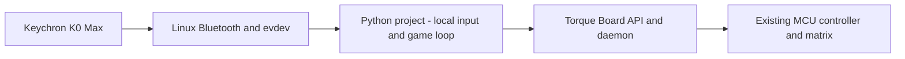

# Keypad input for agent-built projects

**Date:** 2026-10-25, America/Los_Angeles

**Status:** Implemented in source, with host/ARM64 checks and a user-confirmed
physical paddle test. Agent input discovery was verified; a generated-game turn
hit an engine error and resumed, so that game's full acceptance is incomplete.
The helper, discovery tool and skill are deployed in `0.2.0-56a1a1ed2c76`; the
isolated generated game's incomplete acceptance is unchanged. See the
[implementation journal](../journal/2026-10-25-keypad-project-input.md).
The animation gallery now also uses this helper, deployed in
`0.2.0-58ff3c5d6158`; see its
[migration and verification journal](../journal/2026-10-26-shared-keypad-gallery.md).
This spec covers project input, not physical approval/session-command bindings.

## User experience

When a user asks for a game, menu or interactive animation, Torque should consider
available physical input even if the user does not name the keypad. A request to
“build Tetris” can yield keypad-controlled play. An explicit request for autoplay
must preserve autoplay; adding controls is optional, not a change of intent.

The agent checks present input capabilities, loads the `uno-q-input` skill and
uses a shared Python reader. It chooses useful bindings and reports them briefly.
Users do not need to supply Linux key codes, event paths or implementation details.



Keypresses drive the local project, not model requests. This needs no new firmware,
pairing procedure, background input daemon, permission change or keyboard remap.

## Existing evidence

The [Keychron journal](../journal/2026-10-24-keychron-k0-max-bluetooth.md) records
verified Bluetooth input, numpad keys, volume-up/down events from knob rotation,
and mute events from knob press. Physical macro labels were not assigned. Event
numbers changed across reconnects; discover the device by identity.

The [animation gallery](../../examples/06-dot-matrix-animations/README.md) uses
the shared helper for passive numpad selection, descriptor identity, held keys,
repeats and overruns. The capture utility remains a separate manual
diagnostic; games neither run it nor save raw key streams.

## First implementation

1. Add `torque.input`, a dependency-free project input module. Import it explicitly
   so existing SDK entry points and the parallel example-catalog work remain stable.
2. Add a read-only `input_capabilities` host tool and route it through the existing
   daemon authorization path. It returns device metadata and availability, never
   a keystroke stream or held-key values.
3. Package `agent/skills/uno-q-input/SKILL.md`, a focused API reference and a small
   playable falling-pixel/paddle template. Link the guide from the agent's project
   instructions. Skill discovery remains automatic for relevant project requests.
4. Verify parsing, discovery, lifecycle and model-tool plumbing in software, then
   check the physical keypad and a finite demo separately.

The playable template lives inside the skill. The initial implementation left
CLI commands, example manifests, wheel example packaging and the gallery to the
parallel example-command task. The later gallery migration consumes the helper
without changing its preset bindings, launch defaults or cached playback.

## Python API

```python
from torque.input import Keypad, KeypadDisconnected, input_capabilities

available = input_capabilities()  # Metadata only; no queued keys consumed.
with Keypad() as keypad:
    for event in keypad.poll(timeout=0.02):
        if event.action == "press" and event.key == "KP8":
            rotate()
    if keypad.is_down("KP4"):
        move_left()
```

The key loop belongs inside the program's bounded run loop. Events carry a
supported symbolic key, press/release/repeat action and numeric code. A resync
marker means transient state was lost, not that missing presses were reconstructed.
Expose held state separately for time-based movement. Edge actions such as pause,
rotate and confirm should use presses, filtering OS repeats. Ignore keys held
when opening/recovering until released; this prevents an old hold from starting
a new action. Linux documents these distinctions in its
[input event protocol](https://docs.kernel.org/input/event-codes.html).

Discover the Bluetooth keyboard interface using its exact name, bus, VID/PID,
unique identity and numpad capabilities. Recheck the opened file descriptor.
Exclude companion Mouse and unrelated keyboards. More than one readable matching
keypad requires an explicit Bluetooth address; do not choose silently. Never
hardcode one user's address or an event number into the package/skill.

Only project-relevant keys are exposed. Named keys include numpad digits,
operators/Enter, Escape/navigation and `KNOB_UP`, `KNOB_DOWN`, `KNOB_PRESS` for
the surveyed volume/mute codes. Number-row `1`–`9` are also exposed separately
from `KP1`–`KP9` to preserve the gallery's existing bindings.
Labels describe this profile; remapped firmware
may emit different codes and requires a new explicit mapping/diagnostic pass.

## Lifetime and ownership

`Keypad` opens nonblocking, read-only input and closes on context exit. Discovery
does not acquire project ownership or consume queued events. The project reader
holds an owner-only advisory lease for that device, so another cooperating project
fails with a clear busy error. This is logical project ownership, not an exclusive
OS grab: other Linux input consumers can still receive the same physical keys.

Do not install global bindings in this phase. Future harness input must use a
shared focus/routing contract so game controls cannot also approve/cancel a turn.
A future approval binding must identify the exact pending request and session;
keypress repeats cannot become repeated approvals.

On disconnect, clear held state, close the reader/lease and raise a typed error.
The game pauses or exits cleanly; reconnect by rediscovering/opening a new reader.
On `SYN_DROPPED`, discard pending actions, ignore events through the next report,
query current state and suppress old holds. No lost edge is invented. Bound each
poll and keep rendering/game timing independent from input repeat timing.

Missing/inaccessible input is reported without sudo, permission/group edits or
service changes. Explicit manual mode stops if no usable keypad exists. Auto mode
may choose a clearly reported finite autoplay demo. Do not silently claim manual
control when falling back. Terminal input is a separate future/shared adapter;
the physical keypad does not type into a laptop's SSH terminal.

## Agent guidance and example

The skill explains when to discover input, how to use the API, how to choose and
report bindings, and what to do when input is unavailable. It preserves explicit
autoplay and requested durations. It must not turn every animation into a game
or ask the user for file names, Python choices or raw device IDs unnecessarily.

The template catches a falling pixel with a three-pixel paddle. Numpad 4/6 and
knob down/up move it; 5 or knob press pauses; Escape exits. A finite duration and
an offline preview are available. Offline preview never opens input or the MCU.
Execution uses `from torque import Board, Frame`; cleanup releases outputs and
requests clear while communication is available. Framebuffer evidence is separate
from a person's observation of the physical matrix.

## Validation and release boundary

Meaningful checks cover fragmented records, held/repeated keys, overruns, signed
values, descriptor mismatch, multiple devices, denied access, lease contention,
disconnect cleanup and polling bounds. Capability discovery must consume no events
or report held keys. Test that the read-only tool respects argument validation,
works in ask/auto without effect approval, and does not touch hardware outputs.

Check the template's collision/movement/pause behavior, finite autoplay fallback,
offline operation and cleanup after failure. Validate the skill frontmatter and
links. Run the complete repository Python suite after implementation.

On the UNO Q, first inspect metadata without starting a capture or changing
outputs. A deliberate finite live-input trial requires the user to press controls;
record observed application actions/counts without storing raw keystrokes. Confirm
MCU boot identity unchanged, output readback/ownership restored, and no active
reader left after exit. Source checks and temporary development tests are not a
production runtime deployment; record which bundle actually contains the feature.
