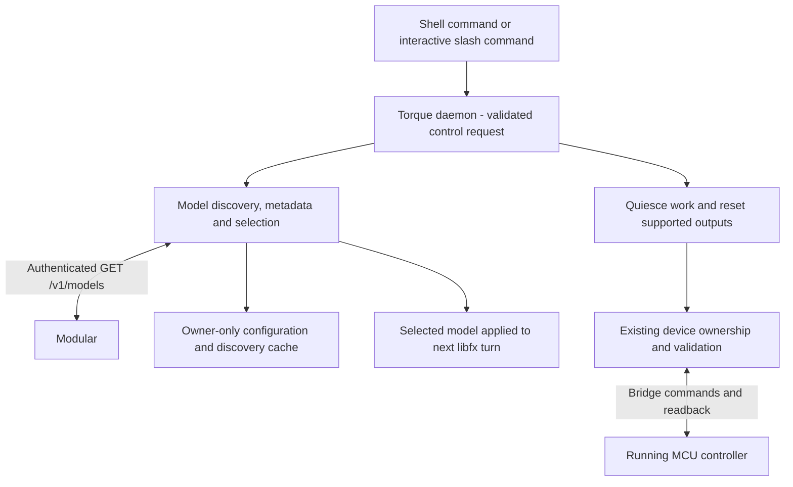

# Model selection and device reset

**Date:** 2026-10-25, America/Los_Angeles

**Status:** Implemented and deployed as `0.2.0-56a1a1ed2c76`. Host/ARM64 controls
and terminal checks, live model switching/continuity, installed text/tool probes,
retained blank and standby reset readback passed through a Linux-only update.
See the
[implementation journal](../journal/2026-10-25-model-reset-and-cancellation.md).

## Goal and current boundary

Users should be able to choose a model and return supported hardware to a known
state through ordinary Torque commands. Both operations belong to the harness;
they are not prompts for the agent to interpret or shell commands for it to invent.

At the design baseline, Torque read its selected model from `~/.config/torque/settings.json`
only at daemon startup, so changing it required a service restart. Setup discovers Modular
IDs through `GET https://api.modular.com/v1/models`, but only accepts models
listed in `config/models.json`. This implementation adds `/model` and `/reset`.
The [current CLI reference](../cli.md) describes implemented commands.

This proposal retains libfx, the existing device coordinator and the MCU
controller. It does not depend on the separate
[native FX runtime investigation](../journal/2026-10-24-native-fx-runtime-option.md).
Normal selection and reset require no sudo, service restart or firmware upload.

## Command surface

| Shell command | Interactive equivalent | Behavior |
|---|---|---|
| `torque model` | `/model` | Show a picker with the current model marked |
| `torque model list` | `/model list` | List discovered models and their status |
| `torque model list --refresh` | `/model list --refresh` | Refresh discovery from Modular |
| `torque model use MODEL_ID` | `/model use MODEL_ID` | Select and persist a model for the next turn |
| `torque model test MODEL_ID` | `/model test MODEL_ID` | Run bounded text/tool compatibility checks |
| `torque reset` | `/reset` | Return managed outputs to standby |
| `torque reset --blank` | `/reset --blank` | Return managed outputs to a retained blank display |

Support `--json` on explicit list/use/test/reset operations for scripts and
future clients. A picker requires a terminal; without one, return usage guidance
instead of selecting an implicit default. Cancelling a picker changes nothing.
An unknown slash command is rejected locally rather than sent as a model prompt.

The daemon owns execution and serialization. CLI and interactive forms call the
same operations and expose the same outcomes.

The user subsequently chose revised interruption behavior: Ctrl-C during active
chat cancels the turn and managed programs, then returns to the prompt. Ctrl-C
at the prompt clears input; `/exit` and Ctrl-D leave chat. SSH disconnection still
detaches. Cancellation preserves completed effects; reset additionally restores
managed hardware defaults. One-shot ask/attach cancel and exit on Ctrl-C.

## Model discovery and metadata

Keep three independent facts: an ID is **discovered**, a profile is **configured**,
and a particular Torque workload is **verified**. A successful listing does not
prove current inference availability, tool compatibility or vision support.

Reuse the existing Models API handling: read the owner-only credential privately,
use the fixed HTTPS endpoint, refuse credential-bearing redirects, bound response
size/count/time and validate model IDs as data. Do not execute API-provided values
or log keys, headers or raw error bodies. Discovery makes no inference requests.

Ship `config/models.json` with the managed release as the curated metadata and
compatibility catalog. Runtime discovery does not rewrite repository files or
modify stock FX's profile. Resolve a selected model as follows:

1. Use exact-ID curated configuration for known models. Preserve any documented
   compatibility flags; do not join IDs through guessed case/prefix aliases.
2. For fields not overridden locally, use provider metadata only when its schema
   and meaning are verified. The current helper extracts IDs only; do not assume
   the list response contains context, modalities or tool capability fields.
3. For an unknown ID, create a clearly marked experimental profile with a
   conservative working context budget, vision disabled and tool support
   unverified. The initial proposed budget is **16,384 tokens**; this is a client
   limit, not a claim about the model's actual context window. Validate how the
   pinned libfx version represents this distinction during implementation.

An experimental model can be selected explicitly without editing the repository.
Show its unverified capabilities in the picker/result. Do not silently copy
another model's advertised metadata or treat unknown tool support as verified.
Models positively identified as incompatible with chat/agent use are listed as
ineligible with a reason. Unknown entries remain visibly experimental; do not
classify them from name substrings. Modular's
[supported-model catalog](https://docs.modular.com/models) distinguishes text,
image and video outputs and shared versus dedicated endpoints.

### Cache and listing

Store discovery data in `~/.cache/torque/model-catalog/catalog.json`, owner-only and written
atomically. Include provider/base URL identity, schema version, retrieval time,
IDs and any validated metadata. Never cache the credential. Invalidate discovery
and verification results when the configured credential/provider changes.

The model-catalog directory is mode 700 and its file mode 600. The enclosing
Torque cache can already be shared/group-writable; do not require it to be private
or change its permissions as part of model discovery.

Use a one-hour freshness window initially. List/picker requests use a fresh cache
or refresh an expired/missing one; `--refresh` always attempts a new fetch. On a
network error, show cached entries with their last-checked time and stale status.
If no cache exists, show curated entries as configured but not confirmed online.
Report a failed explicit refresh even if stale results are also displayed.
Boot, `status` and ordinary chat do not refresh discovery as a side effect.

Show current selection, exact ID, configuration source, discovery freshness and
compatibility status. Distinguish untested, passed and failed checks. A fresh list
that omits the current model marks it unavailable in that listing; it does not
silently select a replacement or erase the user's preference.

Selection requires an ID in the successful discovery snapshot being used. A
previously discovered cached ID remains selectable offline, with a stale warning.
The configured current model remains usable without refreshing the catalog.

## Model selection lifecycle

`use` changes the saved default and the model for subsequent turns, including the
next follow-up in the current conversation. Keep history and completed tool
results; changing models must not replay actions. `/new` remains the explicit
way to discard conversation context for a fresh conversation.

- Serialize selection with turn startup. Reject selection while a turn or model
  compatibility test is active; explain that the user can wait or cancel. Do not
  interrupt or silently queue a change.
- Validate the ID and resolved profile before saving. Update only model-related
  configuration atomically, preserving unrelated settings and credential paths.
- Apply the new configuration in the daemon and recreate/invalidate the idle
  worker as needed. Do not restart the service or disturb device output ownership.
- Selecting the already active ID is a no-op. Report the selected ID and whether
  its profile is experimental; `torque status` must agree.
- If configuration/application fails, keep the previous effective selection and
  report the error. A later provider rejection does not silently switch models
  or retry an effect with another model.

Prove that the pinned libfx durability implementation applies the new model when
resuming history. If it cannot, resolve that engine-adapter gap before shipping
this behavior. Context that exceeds the new budget or incompatible saved content
needs an explicit explanation/recovery choice; do not silently drop history.

### Compatibility test

`test` explicitly authorizes small billable inference requests and announces
their scope. Run a bounded text response and a harmless synthetic tool-call
round trip through the same engine/provider/schema path as Torque. The test
tool has no shell, file, hardware or external-service effects.

Use a temporary conversation and candidate configuration. Testing does not select
the candidate, alter user history or change the permission default. Allow one
test at a time and reject it while normal agent work is active. Bound requests,
tokens and time; support cancellation and retain permission/argument validation.

Record text/tool outcomes separately with timestamp, model ID, engine version,
tool-schema/profile identity and provider/credential generation. A passed probe
does not certify every tool schema or vision support. Invalidate results when
those relevant inputs change. Ordinary list/use requests never run inference
implicitly; offer the explicit test command for unverified models.

## Reset means hardware ready state

`torque reset` is a direct user-authorized control operation. It stops active
Torque work and returns currently supported managed outputs to their defined
defaults. It preserves projects, skills, conversation history, model/provider
selection, credentials, permission configuration and installed firmware.

It does not reboot Linux/the MCU, restart vendor services, flash firmware, erase
resident animation slots or trigger cloud inference. It is separate from factory
reset, uninstall and deployment recovery.

### Reset sequence and ownership

1. Enter a serialized reset phase. Gate new prompts and output ownership/writes
   so a late tool cannot repaint after cleanup.
2. Cancel the active turn and its pending approvals. Cancel and drain supervised
   tool/program tasks, terminating only Torque-managed process groups when
   necessary. Never approve an outstanding action to unblock reset.
3. Reconcile device ownership. If an independently launched program remains the
   owner, report busy instead of killing it, clearing its ownership record or
   racing its writes. This includes a manually launched `torque run` program until
   it is supervised explicitly. Report cancellation already performed separately.
4. For available, compatible hardware, stop matrix playback, abort an active
   Torque-owned upload if applicable, clear retained display intent and turn MCU
   RGB LEDs 3/4 off. Keep the existing boot identity checks and writer validation.
5. Release managed output ownership. Default reset renders the configured standby
   cue; `--blank` instead retains an all-zero frame so session feedback does not
   immediately repaint it. Clearing playback/output does not purge uploaded clips
   or resident preset storage.
6. Read back final matrix/playback and RGB GPIO state, refresh coordinator state
   and report results. Leave the reset phase only after writes and verification
   have settled or the bounded operation has failed.

Both variants are repeatable and converge on the requested output state. Reset
does not reset command counters or invent a new MCU boot. Standby means local
readiness, not successful cloud authentication. Software readback does not prove
the physical LEDs were observed.

### Supported components and future adapters

| Component | Default action | Verification |
|---|---|---|
| Matrix playback and retained scene | Stop playback; clear retained intent; restore standby, or retain blank with `--blank` | Playback stopped and framebuffer matches the selected target |
| MCU RGB LEDs 3 and 4 | All channels off | Valid GPIO readback for both LEDs |
| Torque-managed output programs | Cancel/stop and release ownership | Task/process completion and coordinator ownership state |
| Linux user RGB LED | Include only after Torque has an ownership/restoration adapter; restore saved brightness/triggers if claimed | Sysfs state; otherwise report unmanaged/skipped |
| Future TFT, audio or other components | Add an explicit adapter with a documented default | Component-specific state/readback |

The first implementation covers the coordinated matrix and MCU RGB outputs.
Existing standalone sysfs examples do not establish daemon ownership of the Linux
user LED. Reset must enumerate supported, unavailable and skipped components
without claiming that every board peripheral was reset.

Adapters define capability/ownership checks, bounded reset and verification.
Defaults come from Torque's component contract/configuration, not a model's guess.
The command needs no extra agent approval prompt, but still passes through the
normal account, device ownership, capability and argument-validation checks.

### Failure behavior

Reset is a sequence of hardware effects, not an atomic transaction. Return a
per-component result and a nonzero exit status for busy, timeout, unavailable
hardware or failed readback. Distinguish completed, failed and skipped actions;
never announce a full reset when only some components succeeded.

On disconnect or boot-identity change, stop writing and report the failure. Do
not reconnect and replay mutations automatically, restore a previous user scene
as rollback, or flash/restart components to manufacture a pass. An explicit
subsequent reset can retry against the newly verified state. Sessions and future
normal operation remain available as appropriate to the reported device state.

## Implementation and acceptance

Implement model discovery/profile resolution and daemon selection first. Then
add reset serialization and component defaults. Wire both CLI and slash forms
to the same control operations, extend status/help, and update the installed
command reference only when the commands actually exist.

Unit and integration checks must cover:

- Model cache miss/fresh/stale behavior, refresh failures, malformed/oversized
  responses, credential redirects, exact-ID matching and experimental profiles.
- Known configuration precedence, ineligible model types, credential-safe caches
  and errors, no implicit inference for list/use, and no silent fallback.
- Atomic setting preservation, selection versus active-turn races, worker refresh,
  restart persistence, resumed conversation using the new model and no repeated
  tool effects. CLI and slash results must agree.
- Isolated, bounded/cancellable text and synthetic-tool probes, partial failures,
  unchanged selection/history/permissions and correctly invalidated results.
- Reset during a turn, pending approval, managed program, infinite playback and
  retained scene; absence of late writes; explicit external-owner busy behavior.
- Standby versus retained blank, RGB GPIO verification, repeated reset, unchanged
  MCU boot/presets, disconnect/mismatched firmware and honest partial failure.
- Preservation of user files, credentials, selected model, conversation history,
  permissions and unrelated services for both commands.

After host checks, use a deliberately deployed matched bundle for real model and
hardware acceptance. Exercise model switching with a follow-up, restart persistence,
and both reset variants with independent snapshot/health readback. Record physical
observation separately. Any billable probes or output exercises belong to that
explicit implementation/test step; authoring this proposal performs none.

References: [current architecture](../../ARCHITECTURE.md),
[runtime and engine decision](../torque-runtime.md),
[natural-language control acceptance](../journal/2026-10-24-natural-language-control-and-approvals.md),
[Modular quickstart](https://docs.modular.com/quickstart), and
[Modular model catalog](https://docs.modular.com/models).
