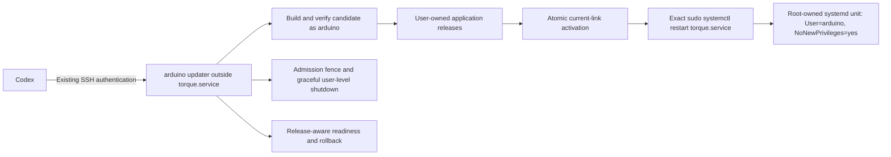

# Unattended runtime updates from Codex over SSH

**Status:** Implemented and verified on UNO Q, 2026-10-26. Administrator bootstrap
completed and a real Linux update committed through noninteractive SSH without
a password prompt. Firmware, service configuration and boot defaults were preserved.

The user selected **Codex over SSH only** for the first version. A one-time
administrator setup makes application releases writable by the existing
`arduino` account and permits exactly one privileged service-restart command.
Routine updates then need no password prompt or human terminal interaction.
This is a current-development-bundle design, not a compatibility framework.

## Scope and authority

Automate explicitly requested Linux application updates: Python code, packaged
examples/manifests, engine adapters, instructions and compatible packaged data.
Keep credentials, model selection, permission defaults, session storage and user
projects outside the artifact. No model request is needed to build or validate
an update. Preserve unmodified libfx and its permission checks.

The running Torque agent does not update itself in v1. The updater executes as
`arduino` in an SSH session **outside `torque.service`**. The service retains
`User=arduino`, `NoNewPrivileges=true` and `KillMode=control-group`.

Firmware installation, Arduino app start/stop, boot-default selection, system
packages, kernel/drivers, user groups and service-unit edits are separate
administrator/operator workflows. A runtime plan requiring another firmware or
an undeclared dependency bundle is rejected rather than repaired automatically.

The sudo grant belongs to the local account, not to a cryptographically
distinguished Codex process. Any process running as that account in a context
where sudo elevation is permitted can invoke the same fixed restart operation.
Existing Torque tool approvals and OS permissions remain in effect.



## Observed baseline

These are point-in-time observations, not hardcoded future identifiers:

| Item | Observed state |
|---|---|
| Runtime parent and release parent | `/opt/torque`, `/opt/torque/releases`: root-owned 0755, not writable by `arduino` |
| Selected release | Advanced from `0.2.0-0fc326137cde` to `0.2.0-6b59d8596260` during this review; CRT Glide remained on key 3 |
| Launcher / system unit | `/usr/local/bin/torque`: root-owned 0755; `/etc/systemd/system/torque.service`: root-owned 0644 |
| State / IPC directories | `/var/lib/torque` and `/run/torque`: UID/GID 1000, 0700 |
| Effective service properties | Active/enabled; `User=arduino`; `NoNewPrivileges=yes`; `KillMode=control-group`; `Restart=on-failure`; no drop-ins at inspection |
| Restart limits | Restart delay 3 s; start-limit interval 10 s; burst 5 |
| Sudo / systemctl | Sudo 1.9.16p2; command path `/usr/bin/systemctl` |
| Signal support | Same-account signal permission confirmed with signal 0 only; `pidfd_open` and `pidfd_send_signal` are available |
| Disk at inspection | Selected release about 276 MB; about 2.37 GB free |
| Virtualenv console scripts | `torque`, `torqued`, `unoq-control` and `pip` shebangs referenced old `.cache/torque/...` build/staging paths |

The launcher currently bypasses those console-script shebangs by executing
`/opt/torque/current/runtime/python/bin/python -m torque.cli`. That explains why
the CLI works while deleting old staging folders could break other entrypoints.

## Pre-implementation findings

This table records the audit that led to the updater. The implementation and
verified behavior are described below; the old root-only staging helper is now
restricted to pre-delegation bootstrap.

| Finding | Evidence | Design consequence |
|---|---|---|
| Current runtime apply requires root and uses separate stop/start operations | [update-runtime.py](../../install/update-runtime.py): `apply` |
| A restart-only grant does not authorize `systemctl stop` or `start` | Current apply and sudo command matching | Stop gracefully as the service's normal UID; reserve sudo for the exact restart command |
| The current updater imports installation helpers from the candidate | `support`, `load_system`, `verify_stage` | All routine updater/build/validation code runs unprivileged; never whitelist user-writable Python under sudo |
| A check of `active`, `pending`, and device owner is not an admission lock | `apply` preflight | Add a daemon update fence and serialize activation with a file lock |
| Working source already has model/reset maintenance, cancellation and probe tasks | [daemon.py](../../packages/session/src/torque/daemon.py): `maintenance`, `start_lock`, `probe_task`, `tool_tasks`; [device.py](../../packages/session/src/torque/device.py): `set_maintenance` | Extend the existing exclusive control mechanism; avoid another independent boolean that another control operation could clear |
| CLI programs run outside the daemon's service control group | [cli.py](../../packages/session/src/torque/cli.py): `run`; [examples.py](../../packages/session/src/torque/examples.py): `run` | Track managed program lifetimes; a service restart alone does not stop these programs |
| A Linux/keypad-only project may never acquire the board writer lock | [input.py](../../packages/session/src/torque/input.py): `Keypad` advisory lease | Device owner alone cannot prove that no project is active |
| Current service closes gracefully on SIGINT/SIGTERM | `daemon.py`: `serve` and `close` | A verified same-UID SIGTERM can release workers, Router observation and IPC before link activation |
| Clean shutdown returns zero and the unit uses `Restart=on-failure` | `serve`/`main`, [torque.service](../../install/torque.service) | Confirm the old service is inactive before changing `current`; unexpected auto-restart aborts the transaction |
| Only the daemon resource root is pinned today; configured execution paths use `current` | `Daemon.__init__`, `start_engine`, `run_model_test`, `execute`; [stage.py](../../install/stage.py): settings paths | Pin node, Python, libfx, examples and assets to an actual release for each process lifetime |
| Existing readiness is not release-aware | `wait_for_ready`, `Daemon.snapshot` | Require a new daemon epoch/invocation and the intended resolved release, not merely a ready device |
| Virtualenvs are currently built in staging then copied | `prepare`, `copy_release`, observed shebangs | Build the new environment at its permanent release path and test every console entrypoint there |
| `pip --no-deps` and copied vendor runtimes assume unchanged dependencies | `prepare` | Check dependency identities explicitly; do not silently ship code expecting another Node/libfx/device-SDK bundle |
| Full setup can rewrite config, change groups and install a controller | [stage.py](../../install/stage.py), [system.py](../../install/system.py) | Routine updates must not call `setup.sh` or the full administrator installer |
| Two independent updates can pass the current stale-plan check before either activates | Another update occurred during this audit; no activation lock in current apply | Use one deployment lock, an expected-base check under that lock and an ownership-aware recovery journal |
| Current release hashes include generated environment files and stage-specific paths | `manifest_files`, console scripts, pip metadata | Separate canonical input identity from output artifact hashes, enabling reliable no-op detection |

Source and installed code are distinct snapshots. The working source's newer
model/reset and project-input controls must be integrated deliberately; their
presence in the checkout does not prove that they are in a given installed
release. Inputs must be frozen and identified before building.

## One-time administrator bootstrap

Keep the existing paths to avoid an unnecessary service/IPC migration:

- `/opt/torque/releases/RELEASE_ID` and `/opt/torque/current` remain the layout.
- Transfer ownership of the activation parent, release parent and **validated
  managed application release trees** to the configured runtime account.
- Keep `/opt`, the launcher, the effective system unit and sudo policy root-owned.
- Preserve `/var/lib/torque`, `/run/torque`, credentials/config and the stable
  Arduino controller path with their existing intended ownership and modes.

Ownership transfer must use lstat/no-follow traversal. In particular, virtualenv
symlinks to `/usr/bin/python3` or `/usr/bin/python3.13` must never cause ownership
changes to those system binaries. Unknown entries, outside-root paths or special
file types stop migration. Do not run a blind recursive chown following links.
Do not make directories group/world-writable or make the application setuid.

Transferring the managed old runtime trees also lets the ordinary updater reclaim
obsolete releases later; changing only the top-level parents would leave old
root-owned contents that it cannot safely remove. Record the ownership changes
and preserve at least the selected known-good rollback release.

The `/etc/sudoers.d/torque-runtime-restart` fragment contains one command rule:

```sudoers
arduino ALL=(root) NOPASSWD: /usr/bin/systemctl restart torque.service
```

Render the actual configured account at installation. The argument string is
part of the restriction: no wildcard, arbitrary unit, Python interpreter, shell,
`SETENV`, `sudo pip`, application installer, or general systemctl grant. Validate
with the installed `visudo` before publishing the root-owned 0440 policy file.
The unit must remain root-owned, run as the intended non-root user, and retain
`NoNewPrivileges=yes`; validate effective properties and drop-ins, not just the
base unit's file hash. Reject unexpected root-phase execution hooks or `+`/`!`
execution prefixes that would run mutable release content with different
privileges. A root-owned unit calling user-owned application code is acceptable
only because that application execution stays under the intended normal UID.

Bootstrap first installs the current development daemon/update client with the
required update-fence/status support, then enables delegation and verifies it.
The administrator bootstrap must be self-contained/reviewed and must not import
installation modules from newly user-writable releases as root. Candidate build
hooks and package smoke tests run after dropping to the runtime UID.
It may use administrator stop/start for this one-time installation. It does not
upload firmware, select another Arduino app, change Bluetooth/router/input
access, or enable/repair unrelated services. An inactive/unexpected baseline is
reported for explicit resolution. No old-daemon compatibility path is required.

After migration, routine instructions must not use
`sudo python3 <release-or-stage>/install/update-runtime.py ...`: application
files are user-writable. The old full administrator/firmware workflows remain
deliberate maintenance, not a passwordless entrypoint.

## Normal update transaction

The implemented CLI is:

```text
torque update prepare --source CHECKOUT
torque update prepare --source CHECKOUT --scope examples
torque update apply UPDATE_ID
torque update status UPDATE_ID
torque update recover UPDATE_ID
torque update gc
```

Codex invokes it through existing noninteractive SSH authentication. It executes
as the runtime owner and rejects being run as root. There is no password fallback.

1. **Freeze inputs and declare scope.** Identify the source snapshot, selected
   files/wheels, dependency bundle and compatible controller identity. Support
   an examples-only update based on the active release; never silently include
   another agent's unrelated uncommitted application changes. Detect input
   mutation during build. No credentials or user state belong in the artifact.
2. **Build at the permanent path.** Derive `RELEASE_ID` from canonical inputs,
   allocate its final directory as the runtime user, and build a fresh Python
   environment there. Keep it marked incomplete until verified. Do not move a
   built venv between staging/final prefixes. Existing Node/libfx and locked
   Python dependencies must match the plan; otherwise reject or prepare a
   separately reviewed complete bundle. Do not hardlink mutable candidate files
   to the active runtime.
3. **Validate without hardware effects.** Verify manifest/path containment,
   file hashes, package version/dependencies, imports, Node native-backend
   metadata and required packaged resources. Test list/help/offline previews
   with the actual candidate interpreter. Add configuration-only daemon
   validation without opening a second MCU observer, resetting outputs, writing
   settings or sending a model request. Check console scripts after all temporary
   build paths are unavailable. Reserve disk space for build and rollback.
4. **Lock activation and recheck the base.** Hold an exclusive deployment lock
   under `/var/lib/torque` through apply/rollback/recovery. Compare the current
   resolved release with the expected base **under that lock**. A stale plan
   aborts/restages; it cannot roll back another successful transaction.
5. **Acquire the daemon update fence.** In one serialized control operation,
   check model turns, pending approvals, cancellation, model selection/test,
   reset/maintenance, outstanding tools, device writers and managed project
   leases. Reject busy work without cancelling it. Fence new prompts, model/reset
   mutations, program launches, output acquisition and writes. Read-only status
   remains available. Return update ID, daemon epoch and process identity.
6. **Gracefully stop as the normal account.** Confirm the effective unit/PID/UID
   still belongs to this daemon. Pin the process with the available pidfd API
   and signal SIGTERM as the same UID. Wait for clean shutdown and inactive
   service state before activation. The service's current SIGTERM path already
   drains workers/device observation and removes IPC. A bounded stop failure,
   changed invocation or unexpected auto-restart aborts; no sudo stop permission
   is needed. Do not signal guessed/reused PIDs or kill unrelated project jobs.
7. **Activate atomically.** Persist the transaction phase/previous release, then
   atomically replace `current` using a sibling temporary symlink on the same
   filesystem. Flush journal/link directory metadata. Do not edit the active
   release in place. Persistent update state keeps the new daemon in maintenance
   until verification completes.
8. **Restart through the sole privileged command.** Use explicit argv:
   `sudo -n /usr/bin/systemctl restart torque.service`. Check delegation and
   caller `NoNewPrivs` before quiescing; a denied grant reports that bootstrap or
   administrator repair is needed. Never broaden sudo policy, prompt for a
   password or run candidate Python as root.
9. **Attest the actual running release.** Status must report the daemon's
   resolved release root/ID and application version. Require a new epoch and
   systemd invocation, the intended release, normal device readiness and the
   same MCU boot ID/version/protocol. Preserve the existing boot-default path,
   effective unit configuration, selected model and permission defaults. A
   configured credential-ready state must not regress, but do not read/log its
   value or make a cloud model test. Verify held user output through existing
   adoption semantics, not by replaying actuator commands.
10. **Commit and release the fence.** Atomically record success/previous release
    and clear maintenance. Source files, runtime manifest and receipts all name
    the intended artifact. Failure to write the final receipt must not cause a
    verified activation to be repeated blindly.

The privilege grant is useful only outside the service's `NoNewPrivileges`
context. Keep that setting enabled; the updater is not a Torque model tool or
service child. The root-owned systemd manager executes the selected application
as `arduino`, not as root.

## Admission, path and lifecycle details

Reuse the working source's existing maintenance/start-lock machinery with an
exclusive reason/owner. A model-test or reset completion must not accidentally
clear an update fence. Gate `Device.acquire`, direct writes and new tools as
well as the chat prompt; checking status once is insufficient.

`torque run` and live `torque example` launches need managed process leases even
when they never write to the MCU. A keypad advisory lock alone is not a service
program registry. Child lifetime must remain visible if its frontend disconnects.
Unmanaged processes started directly by the user are outside this guarantee and
are never killed or guessed away by the updater.

Listing/help/offline previews must retain their no-daemon behavior. Pin their
example resources and Python environment to the actual release, with a local
release-use lease for safe retention. Resolve a venv **directory**, then use its
`bin/python`; resolving the Python symlink all the way to `/usr/bin/python3.13`
would lose the venv. In the daemon, pin execution paths for node, Python and
libfx once per process; keep persisted settings pointing at `current` for the
next launch. Validate all spawn sites, including model tests and workspace tools.

The updater's process must be outside `torque.service`, whose control group is
terminated during restart. V1 remains an SSH-supervised operation: SIGINT,
SIGTERM and SIGHUP enter bounded recovery. Persist phases so an untrappable
kill, power loss or broken SSH session is recoverable on the next Codex
connection. `setsid` alone is not a guarantee against session-cgroup cleanup;
do not claim a durable background updater without testing its logind lifecycle.
A separate persistent update worker is deferred with Torque self-updates.

## Failure, recovery and storage

Journal phases include prepared, fenced, stopped, activated, restarted, verified,
committed and rolling-back. Record artifact/base IDs, epochs/invocations,
boot identity, timestamps and results. Do not log credentials, the environment,
conversation content or pending approval arguments. Use atomic private writes.

- Before activation, unwind the fence and restart the previous runtime if it
  was deliberately stopped. An initially inactive service is not auto-repaired.
- After activation, restore the previous verified link and use the same fixed
  restart command. Bound retries; do not loop deployments or mutate firmware.
- If the intended runtime is already running and all checks pass after an
  interrupted finalization, complete bookkeeping without another restart.
- If another transaction owns the active release, do not undo it. Recover only
  the transaction whose journal/base/activation state matches reality.
- Respect the observed systemd start-rate limits. After rollback, allow the
  rate-limit interval to expire before retrying the exact restart command when
  necessary. Do not acquire `reset-failed`, arbitrary start/stop or broad systemd
  authority as an automatic workaround. Persistent failure is reported with
  the previous release and recovery state.

Keep the active runtime, one verified rollback and releases with live use
leases. Reclaim only validated, inactive, user-owned managed releases and this
updater's known build/staging artifacts. Never remove a workspace project,
credential, unknown directory or symlink target. Garbage collection uses the
same deployment lock. The observed 276 MB release and 2.37 GB free make retention
a practical requirement, not an unlimited keep-every-build policy.

Automatic retention and stronger storage admission are specified separately in
the [managed-storage draft](2026-10-26-managed-storage-retention.md). The current
release GC remains explicit; that draft does not describe deployed behavior yet.

Compare canonical input/dependency identity for no-op updates. Generated pip
metadata, shebangs and staging paths must not force restarts for unchanged source.
Store output hashes separately for integrity/recovery. Data/state schema changes
requiring irreversible writes cannot use an automatic rollback assumption;
reject them from v1 unless the update plan defines a reversible procedure.

## Implementation plan and acceptance

1. Refactor the normal runtime updater to run without root, build at permanent
   prefixes, enforce input scope/dependency identity, lock/CAS activation and
   persist recoverable phases. Leave full setup/controller deployment separate.
2. Add release-aware status, admission fencing, clean shutdown handoff and
   managed program/release leases. Integrate model/reset/input controls rather
   than creating competing maintenance state. Pin process-lifetime paths.
3. Implement a dry-run-first one-time bootstrap: validate the actual account,
   managed directory graph, effective unit/drop-ins, signal semantics and exact
   sudo command; back up policy/ownership metadata; apply no-follow ownership
   transfer and the validated narrow rule. This step requires explicit admin
   authorization and must be resumable if interrupted.
4. Verify software behavior before enabling delegation: busy/reset/model-test
   races, new work after preflight, two concurrent deployers, changed source,
   missing dependencies, malformed manifests, path/link escapes, moved venv
   entrypoints, wrong daemon release, failed startup, start-limit rollback,
   signal/SSH loss, full disk and interrupted receipt writes.
5. On the board, exercise a non-hardware application/example metadata update
   through noninteractive SSH. Prove the target release/epoch changes, firmware
   boot identity does not, retained user output is adopted without actuator
   replay, the unit/boot default stay unchanged, and no model request occurs.
6. Verify the delegation's exact scope with policy inspection and harmless
   checks. Never restart an unrelated unit as a negative test. Existing general
   sudo password caches must not be mistaken for the new no-password policy.
7. Document `torque update` and recovery in [cli.md](../cli.md), change bootstrap
   ownership defaults for fresh installations, and remove routine instructions
   to sudo user-writable Python helpers. Revocation removes only the dedicated
   root-owned rule; it does not reflash or stop the running system automatically.

## References and remaining decisions

The actor decision is resolved: Codex over SSH only. Board migration and a real
noninteractive activation passed. Same-source preparation and repeated apply both
returned without restarting the daemon. Delegation is enabled on the validation board.

## Implementation details

- [runtime.py](../../packages/session/src/torque/runtime.py) owns private records,
  atomic fsync writes and kernel flock leases. Live CLI/example children inherit
  the shared program descriptor and retain it even after the frontend exits.
  This implements project lifetime tracking without a competing daemon PID
  registry. Read-only resource users hold per-release leases for retention.
- [update.py](../../packages/session/src/torque/update.py) builds fresh venvs at
  final prefixes, copies only the frozen dependency bundle, recreates all console
  scripts, and tests source parity, offline previews, entrypoints and native
  libfx loading. Preview smoke checks receive an unavailable Torque socket.
  Application and examples-only scopes are explicit. Canonical identity excludes
  installation-location metadata and includes actual dependency code/vendor data.
- The bootstrap release has a stable identity derived from its reviewed stage,
  and is rebuilt at a separate permanent prefix. Subsequent releases derive
  their names from canonical inputs. The bootstrap adds a hash-pinned
  `setuptools==84.2.0` build wheel; subsequent updates build offline with that
  frozen toolchain. Runtime dependency changes are refused.
- The [standalone bootstrap](../../install/bootstrap-runtime-updates.py) imports
  only stdlib as root and runs all candidate code after dropping UID. Directory
  traversal and ownership migration use no-follow descriptors. Existing symlinks
  inside releases may retain root ownership; their targets are never chowned.
  The `current` link and application parents become owned by the runtime account.
- Daemon status reports the actual installed application version, resolved release,
  PID, epoch and fence owner. A persistent fence survives restart and blocks
  prompts, model/reset controls, device writers and new managed program launches.
  Clean shutdown uses pidfd plus UID, service-cgroup and invocation validation.
- The exact restart grant is checked through sudo policy listing, independently
  of a cached general sudo password. Start-limit recovery retries only the same
  restart command after a bounded interval. Failed/stopped services with no PID
  can be rolled back; unrelated processes and service units are never signaled.
- Private records live under `/var/lib/torque/updates`; administrator migration
  progress is root-owned at `/var/lib/torque-runtime-bootstrap.json`. Verified
  activations with interrupted receipts are finalized without another restart.
  GC preserves current, rollback, prepared targets and leased releases, and can
  clean recognized incomplete builds. Unknown/modified trees are skipped.
- Fresh installation can opt into the same bootstrap with
  `./setup.sh --enable-unattended-updates`. Existing working boards use the
  separate Linux-only bootstrap; they do not run full setup or controller upload.
- Arduino's existing vendor sudoers fragments use root-owned mode 0644. Global
  validation uses `visudo -cf /etc/sudoers` to check all included syntax, then
  requires each parsed file to be root-owned and not group/world-writable.
  The dedicated Torque rule remains strictly 0440. Vendor permissions are not
  rewritten. The initial overly strict `visudo -c` check was corrected and the
  interrupted bootstrap resumed without reinstalling/restarting the healthy app.

- [Architecture](../../ARCHITECTURE.md), [runtime update workflow](../../install/README.md),
  [example catalog design](2026-10-25-example-catalog.md).
- [systemd execution policy](https://www.freedesktop.org/software/systemd/man/latest/systemd.exec.html#NoNewPrivileges=)
  explains the no-new-privileges boundary. The installed service properties and
  local manuals were checked directly; the online manual covers newer releases.
- Installed `sudoers(5)` for sudo 1.9.16p2, command-argument matching, and the
  [upstream manual](https://www.sudo.ws/docs/man/sudoers.man/). Exact arguments
  are required: a command rule omitting arguments would allow arbitrary ones.
