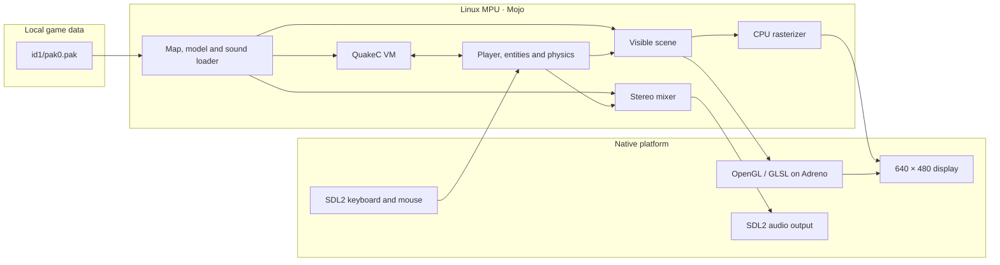

# Quake on the UNO Q with a Mojo engine

**Design draft · November 18, 2026**

The proposed first release is **Dimension of the Doomed**, the original PC shareware episode. Open Quake from the UNO Q desktop, choose difficulty in the start map, play through the Slipgate Complex, defeat Chthon and return with the first rune. Support both the ordinary route and the secret detour. The first implementation milestone uses a tiny original test room. The first gameplay milestone ends when the player wins a real encounter in E1M1 and crosses the slipgate into E1M2. [Original player manual](https://github.com/id-Software/Quake/blob/master/WinQuake/data/MANUAL.TXT) · [Released map sources](https://rome.ro/news/2016/2/14/quake-map-sources-released)

## Full campaign scope

The same engine can target the **complete registered 1996 single-player campaign**. Phase 5 accepts the shareware episode. To extend that release, point the game at the classic `id1/pak0.pak` and `id1/pak1.pak` from a registered copy, identify both files and the effective `progs.dat`, and inventory maps, scripts and resources again. Quake gives the later PAK precedence. A single-map launch tests loading. Campaign acceptance requires carrying the first rune back through the hub, completing Episodes 2–4 and their secret levels, returning with all four runes, and defeating Shub-Niggurath in `end`. Cross-renderer saves must preserve the runes through that final transition. The retail files stay with the player. [id’s source and data release notes](https://github.com/id-Software/Quake/blob/master/readme.txt) · [Original Quake filesystem](https://github.com/id-Software/Quake/blob/master/WinQuake/common.c)

## Where the code runs

The standalone executable runs on the UNO Q’s ARM64 Linux MPU. Mojo owns input mapping, the simulation clock, 3D collision, game-state serialization, audio mixing and scene preparation. A **Mojo interpreter executes the original QuakeC bytecode** in the player’s `progs.dat`. QuakeC defines when a grunt wakes up, how a door moves and what happens when the player exits a level. Mojo must supply the engine operations those scripts call. [QuakeC interpreter](https://github.com/id-Software/Quake/blob/master/WinQuake/pr_exec.c) · [Engine builtins](https://github.com/id-Software/Quake/blob/master/WinQuake/pr_cmds.c)

Reuse the DOOM port’s ARM64 build, thin C/SDL2 platform layer, keypad handling and replay-testing approach. Quake needs its own loader, collision hulls, entity model and renderers. Python can prepare assets and run verification offline. The desktop executable must work with Python absent. Keep the player’s PAK and any soundtrack tracks outside Git. Record the supported PAK digest and package the project’s own fixture separately. id released the engine source and retained separate terms for the game data. [DOOM platform baseline](../../projects/mojo-doom-switchyard/README.md) · [id’s source-release notes](https://github.com/id-Software/Quake/blob/master/readme.txt)

## Implementation phases

### 1. Walk a room on the board

Build the native executable and a redistributable BSP29 test room containing a stair, a low ceiling, a ledge and a water pool. Load textures, lightmaps and collision hulls. Draw textured, depth-tested geometry in a **320 × 240 Mojo software framebuffer** and present it at 640 × 480. Implement mouse yaw and pitch, walking, sliding, jumping, falling and swimming. Add a headless path that consumes the same player commands. [BSP format](https://github.com/id-Software/Quake/blob/master/WinQuake/bspfile.h) · [Original physics](https://github.com/id-Software/Quake/blob/master/WinQuake/sv_phys.c)

**Board playtest.** Climb the stair, hit the low ceiling on a jump, drop from the ledge, swim back out and quit from the K0. Replay those inputs headlessly and compare position, velocity, grounded state and water level. Then open the original `start` map and inspect the spawn view against a reference screenshot.

### 2. Win the first encounter in the Slipgate Complex

Load `progs.dat` globals, functions, fields and strings. Spawn the BSP entity list, schedule think/touch/use callbacks, and implement the builtins exercised by E1M1, including collision traces, entity linking, damage-related events, sound and level change. Inventory missing operations by map, entity and builtin name. Render animated alias models and the view weapon. Mix the original WAV effects with listener-relative positioning. [Alias-model format](https://github.com/id-Software/Quake/blob/master/WinQuake/modelgen.h) · [Original sound system](https://github.com/id-Software/Quake/blob/master/WinQuake/snd_dma.c)

**CPU playtest.** Enter E1M1 through the start map on Normal. Alert a placed grunt or rottweiler, take damage, break line of sight behind a wall, kill the enemy, collect a pickup and exit into E1M2. Save while the enemy is active, quit, reload and reproduce the outcome. Record the encounter from ordinary player input so it becomes the first regression test. [E1M1 entity placements](https://github.com/fzwoch/quake_map_source/blob/master/e1m1.map)

### 3. Render the same fight on Adreno

Give the CPU and GPU a read-only view of the same world. Share BSP visibility selection, animated model poses and light-style values. The GPU backend batches visible faces by texture and lightmap, then draws moving brush models, enemies, particles, sky, water and the HUD. Keep renderer handles and interpolation out of saves.

**Board comparison.** Replay the phase 2 fight through both renderers, compare simulation hashes at the same ticks, and resume a CPU save on GPU and vice versa. Capture matched 320 × 240 views of a moving door, a model partly behind a wall and a water boundary. Then measure Adreno at native 640 × 480. Record the driver and actual renderer so a software OpenGL fallback is visible in the results.

### 4. Finish Episode 1 through both routes

Build a per-map inventory of entity classes, QuakeC builtins, models, sounds and transitions from the selected PAK. Close the gaps using the original placements and scripts. Cover keys, buttons, lifts, crushers, teleports, secrets, hazards, armor, powerups and the weapons and enemies used by the episode. Preserve the script-defined inventory and rune state across transitions. Save the map and data identity, simulation time, RNG, VM globals, live entities and their references, scheduled callbacks, projectiles and movers. Restore into a fresh process with either renderer.

| Playtest | Required outcome |
|---|---|
| Ordinary route | From New Game, complete E1M1 through E1M7. In House of Chthon, operate the electrodes and lightning control, defeat Chthon and reach the episode ending with the rune. |
| Secret route | Take the secret exit in E1M4, play E1M8 with its low gravity, then return to E1M5 with normal gravity and finish the episode. |
| Recovery | Die and restart a level. Separately, save with a lift moving and a projectile in flight, relaunch using the other renderer, and compare the resumed state. A corrupt or mismatched save must leave the current game playable. |

**Campaign acceptance.** Both continuous input recordings must reach the finale from the original start without warps or seeded saves. Compare hashes at every map entry and exit. Keep a coverage row for each map with its exits, required triggers, build and last successful board run. [E1M4 exits](https://github.com/fzwoch/quake_map_source/blob/master/e1m4.map) · [E1M8 return](https://github.com/fzwoch/quake_map_source/blob/master/e1m8.map) · [Chthon encounter](https://github.com/fzwoch/quake_map_source/blob/master/e1m7.map)

### 5. Ship the desktop game

Add the Quake desktop shortcut, renderer selection, HUD, menus, quicksave/load and focus handling. Proposed K0 bindings are **8/2** forward/back, **7/9** strafe, **4/6** turn, **5** fire, **Enter** jump or confirm, **3** cycle weapons, **+ / −** save/load, **\*** pause and **0** quit. Mouse movement controls yaw and pitch, with left click to fire. For keypad-only play, use **KP1** to look up and **keypad decimal** to look down. Mix ambient water and machinery with simultaneous combat effects. Support local soundtrack tracks when supplied. Classic Quake used CD audio for music. [Original manual](https://github.com/id-Software/Quake/blob/master/WinQuake/data/MANUAL.TXT)

**Desktop playtest.** Launch each renderer from the shortcut. Test the physical K0 with Num Lock on and off, aim vertically with the mouse, hear effects on the mounted speaker, save, quit and resume. Confirm that focus loss releases the pointer and clears held movement. Record hands-on observations separately from synthetic input and audio-queue measurements.

### 6. Complete the registered campaign

Start a fresh game on Normal with the player's classic registered PAKs. Recheck Episode 1 with the registered scripts, then play Episodes 2–4 from the hub. For each episode, record the ordinary route and its secret detour, verify the return map and check that previously collected runes survive each transition. Exercise newly encountered enemies, traps, sounds and scripted events on the board. Use the same player inputs and compare simulation hashes on CPU and Adreno.

**Release test.** Make a quicksave after collecting three runes, quit, switch renderers and resume. Collect the fourth rune, enter `end` from the hub, defeat Shub-Niggurath and reach the original ending. Repeat the final transition in the opposite renderer direction. Passing this test and the episode route checks establishes support for the original four-episode PC single-player game. Mission packs, multiplayer and the remaster are separate projects.

## Timing and release decision

Start with a proposed **72 Hz simulation step** and independently paced rendering. Validate jump distance, acceleration, door timing and QuakeC attack cadence against original-engine behavior before freezing that rate and the replay format. Log missed simulation ticks and input commands. A slower render frame must still process every scheduled game tick.

Measure three real-time scenes with sound on the board using a crowded E1M1 fight, a lightmapped water view in E1M4, and a map transition. Record median and p95 frame intervals, peak resident memory, CPU time and empty audio-queue events. The proposed CPU floor is **30 FPS** at 320 × 240 with p95 at or below 33.3 ms. The Adreno target is **60 FPS** at 640 × 480 with p95 at or below 20 ms. Publish the measured result for each mode. DOOM measured 17–18 ms p95 on this board. Use Quake’s own measurements to choose the default renderer. [DOOM board measurements](../../projects/mojo-doom-switchyard/evidence/episode1-verification.md)
