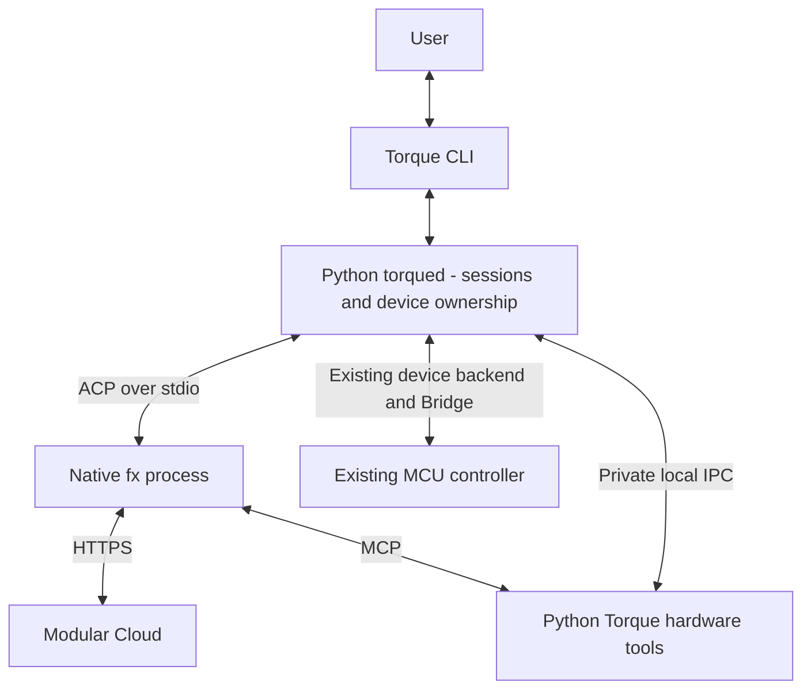

# Future runtime option: native FX without Node

**Date:** 2026-10-24, America/Los_Angeles

**Status:** Future investigation. Keep the working Node/libfx integration for
now. No migration, runtime removal or firmware change is authorized by this note.

## Why revisit the engine adapter

Torque currently hosts unmodified native `libfx@0.0.14` through a private Node
runtime. Node hosts the JavaScript adapter and native addon; Modular performs
model inference in the cloud. The worker starts on demand and exits after
30 idle seconds. The Python daemon remains available for sessions and hardware.

The user proposed replacing this arrangement with native `fx` to reduce package
size and potentially improve memory, CPU usage and startup time. This would
change the Linux engine adapter, not the MCU controller or cloud model.
Performance improvement remains a hypothesis to measure.

## Measurements behind the discussion

Read-only observations on the UNO Q during this conversation:

| Observation | Result and interpretation |
|---|---|
| Private Node runtime directory | About 204.4 MiB allocated on disk |
| Installed libfx package | About 45.8 MiB allocated on disk |
| Native stock FX executable | About 11.3 MiB; the executable alone is not a complete replacement installation |
| Idle engine worker | No Node worker present during the latest check |
| Idle Python Torque daemon | 28.4 MiB RSS |
| Idle daemon CPU sample | 0.96% of one core over 2.08 seconds; a short observation, not a sustained average |
| Available board memory | About 2,963 MiB of 3,667 MiB usable memory during that check |
| Earlier active engine proof | About 119 MiB combined Node/native-libfx process RSS sampled near the end of the proof; not Node alone or a continuously measured peak |
| Active-turn CPU comparison | Not measured |

The clearest current cost is roughly **250 MiB of installed Node/libfx files**.
Disk footprint is separate from resident memory. Some libfx package files target
other platforms; pruning those is a separate, smaller optimization if worthwhile.
The observed idle overhead does not make Node removal an urgent requirement on
the 4 GB board. Local tool/program workloads also consume resources independently
of the engine host.

## Candidate approaches

| Approach | Benefit | Tradeoff to investigate |
|---|---|---|
| Native FX terminal plus Python MCP hardware tools | Reuse FX's terminal, coding tools and sessions with fewer Torque frontend responsibilities | Would change how Torque owns session interaction and physical controls |
| Torque CLI/daemon plus native `fx acp` and Python MCP hardware tools | Preserve Torque's session/device interface while replacing the Node worker | Requires a verified ACP adapter, permission integration and event mapping |

The second approach is the provisional direction for a prototype because Torque
is intended to support physical feedback and session controls as well as coding.
It is not a final architecture decision.

FX documents ACP session methods, streamed tool activity, permissions and
cancellation. Its MCP support can expose local tools, including a proposed
Python hardware server. These documented building blocks do not establish
compatibility with every existing Torque behavior. See the
[ACP documentation](https://fx.sh/docs/using-fx/acp) and
[MCP documentation](https://fx.sh/docs/capabilities/mcp), reviewed for this entry.

## Questions the prototype must resolve

- **Configuration and credentials:** native FX 0.0.14 uses `~/.fx`, while the
  current library integration keeps Torque configuration and sessions separate.
  Decide whether to share that profile or find a supported isolation mechanism.
  Preserve existing settings/history and the real account home; do not fake
  `HOME`. Verify that provider credentials remain outside logs, command arguments,
  project files and tool subprocess environments.
- **Authorization:** Torque's current `auto` category policy is not automatically
  equivalent to FX's policy. Prove routine board actions avoid repeated prompts
  while other effects retain the required checks. MCP server trust does not grant
  blanket approval for its tool calls. Do not use full access to make tests pass.
- **Events and controls:** map actual ACP events to Torque's session state and
  physical feedback. Check cancellation, pending approvals, resume, disconnect
  and reattachment. Do not infer model activity or user-wait states by parsing
  terminal prose; ACP may not expose every current libfx hook.
- **Tools and models:** determine which coding tools FX should own and which
  hardware operations remain Torque tools. Preserve validation, output ownership
  and retained scenes. Recheck Modular model/tool compatibility; switching the
  host does not prove historical tool-schema failures disappear.
- **Distribution:** pin and verify the ARM64 FX binary, manage its update lifecycle
  deliberately, and account for any new Python/MCP dependencies. Keep a matched
  working runtime available until replacement acceptance passes.

## Evaluation and adoption gate

1. Build an isolated developer prototype without changing the working service,
   global FX profile, controller firmware or user workspace.
2. Run the same plain-language acceptance: “light up all led matrix now,” then
   “turn it off.” Require zero routine approvals, retained on/blank state and
   independent framebuffer readback. Also test program creation/execution from a
   simple sentence, explicit permission denial and absence of unintended effects.
3. Verify skills/instructions, durable conversations, cancellation, pending
   approval handling, frontend disconnect/attach and daemon restart without
   replaying effects. Confirm display ownership and physical-feedback event
   semantics still hold.
4. Compare matched workloads on the same board/model: installed footprint,
   idle/active/peak RSS and preferably PSS, CPU over meaningful intervals, cold
   startup and end-to-end turn latency. Include the Python MCP process and tools
   in the replacement's totals. Record versions and observation limits.
5. Choose adoption only after the evidence shows worthwhile gains with acceptable
   integration cost. A smaller executable alone does not establish faster turns
   or lower whole-system memory use. Plan a deliberate cutover and recovery path.

Until then, prioritize the working user experience. The current Node worker is
on demand, its observed resource cost is reasonable, and this remains an optional
future optimization.

Related: [current architecture](../../ARCHITECTURE.md#runtime-components-and-communication),
[original engine decision and proof](../torque-runtime.md#engine-decision),
and [plain-language control acceptance](2026-10-24-natural-language-control-and-approvals.md).
