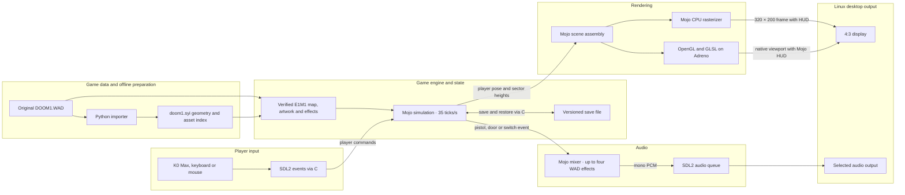

# DOOM Hangar on the UNO Q

DOOM Hangar is a Mojo implementation of **E1M1: Hangar** exploration gameplay using id Software’s original DOOM shareware 1.9 assets. The Mojo main loop advances the simulation at 35 ticks per second. Both renderers draw from the same game state and share the same saves.

## Architecture

In CPU mode, Mojo draws the pixels. In GPU mode, Mojo prepares the scene and OpenGL shaders written in GLSL draw it on the Adreno. A C layer starts the program and connects Mojo to SDL2, graphics, audio and file I/O. Python prepares the asset index and runs verification tools. The installed game runs without Python.



## Play

Open **DOOM Hangar** on the UNO Q desktop for CPU rendering. Its **Play with Adreno OpenGL** desktop action selects the GPU. Both modes share the same save slot. Keyboard, mouse and the K0’s desktop numpad events are supported.

| Action | Control |
|---|---|
| Move forward / backward | W / S, Up / Down or KP8 / KP2 |
| Strafe | A / D or KP7 / KP9 |
| Turn | Relative horizontal mouse movement, Left / Right or KP4 / KP6 |
| Fire | KP5, KP1 or left click |
| Use a door or exit | Space, Enter or numpad Enter |
| Save / restore | Keypad + / − or F5 / F9 |
| Toggle controls legend | Keypad / or Tab |
| Quit and release the pointer | **Keypad 0** (including Insert), **Backspace**, ordinary 0 or Escape |

The initial camera is at the map’s actual player start. Firing animates the pistol, consumes a round and plays the original sound. Walk up to a regular door and press Use to raise it. Pressing Use at the exit switch marks the level complete. On focus loss the engine clears held controls and releases the pointer. Click inside the window to recapture it.

## What is implemented

The original mode reads Hangar’s map records, BSP, palette, light tables, wall patches, floor/ceiling flats, single-view sprite artwork, pistol frames, status bar and digits from the verified IWAD. The game decodes the original DMX pistol, door-opening and switch sound effects and mixes up to four voices in Mojo. A small preparation tool derives convex floor triangles and texture placement metadata ahead of launch. The generated index references the original artwork by byte offset.

The simulation handles walking, collision, step height, manual doors, use/fire commands, level exit and versioned saves. For example, firing consumes a round, starts the pistol flash and triggers the original sound effect in the same tick. The CPU renderer projects, clips and depth-tests textured triangles. The GPU renderer submits the same geometry and sector heights to OpenGL for projection and texture sampling.

**Scope:** E1M1 is an exploration milestone. Actors are stationary sprites; enemy AI, enemy damage, pickups, animated world textures, all linedef specials, original music playback and the rest of the campaign are future work. The sky and texture pegging are approximate. Only the verified 1.9 shareware IWAD and its matching index are supported. The CPU implementation for this map uses textured triangles, an implementation difference from the column/span renderer in the [design](../../docs/design-spec/2026-11-18-mojo-doom-dual-renderers.md).

## Original media

The user’s game-data directory on this board is `~/.local/share/switchyard/`. It holds the intact original shareware distribution, its extracted `doom1.wad`, and a local `doom1.syi` index. The project source contains the importer and a separate original test fixture. A fresh checkout needs a local copy of **DOOM shareware v1.9** for Hangar. Keep the original distribution and its accompanying notices together. [id Software shareware release listing](https://legacy.doomworld.com/idgames/idstuff/doom/doom19s) · [id Software engine source](https://github.com/id-Software/DOOM)

| File | SHA-256 |
|---|---|
| Original `doom19s.zip` | `cacf0142b31ca1af00796b4a0339e07992ac5f21bc3f81e7532fe1b5e1b486e6` |
| `doom1.wad` | `1d7d43be501e67d927e415e0b8f3e29c3bf33075e859721816f652a526cac771` |
| Prepared E1M1 index | `cc74ab636213b2f002631f913edb3f618106f772afbd77dd6a7477f680da4f6d` |

To prepare an existing matching WAD once, run `python3 import_iwad.py /path/to/doom1.wad` in a writable game-data directory. The runtime verifies the known WAD and index pair before accessing their tables.

## Build and run

From this project directory on the Mac:

```bash
./build.sh host
./build.sh unoq
```

The build uses Mojo 1.2.0, the existing Zig 0.17.1 Linux linker and SDL2 headers. Paths default to the retained tools under `../mojo-exploration`; override `MOJO`, `ZIG` and `SDL2_INCLUDE` if needed. The executable loads the native SDL2 shared library dynamically. IWAD verification on Linux additionally uses the existing libcrypto.so.3. The ARM64 binary targets Cortex-A53 and glibc 2.34. Preserve the `build/` and `assets/` directories relative to each other.

On the UNO Q:

```bash
cd ~/torque/projects/mojo-doom-switchyard
media=~/.local/share/switchyard
./build/switchyard-unoq --renderer=cpu --iwad "$media/doom1.wad" --index "$media/doom1.syi"
```

Use `--renderer=gpu` to select the Adreno, `--windowed` for a debugging window, `--mute` for silent operation and `--resume` to open the saved game. Fullscreen fits the current desktop. CPU rendering uses a 320×200 logical buffer with 4:3 presentation. GPU world geometry draws at the actual viewport resolution. Save files are per-user files in the working directory, and `--save FILE` selects a different slot.

## Reproducible checks

```bash
./build/switchyard --check
python3 verify.py ./build/switchyard-unoq --iwad "$media/doom1.wad" --evidence /tmp/switchyard-checks
```

The first command checks the deterministic fixture without opening a window or audio device. The second command is an on-board foreground graphics/audio trial. It runs short command traces, compares final game-state hashes and checkpoint bytes, and restores CPU saves in GPU mode and GPU saves in CPU mode. Its save slots are temporary. Reported rates count software loop iterations. Screenshot captures use PPM.

The small **Switchyard** PWAD provides an original testing room with an opening airlock, a lamp and an exit switch. Run the executable with `--fixture` to try this fixture. It has different artwork and synthetic tones. Walk toward the striped shutter, use it, pulse the relay lamp and use the marked far wall. Normal play selects the original shareware level and effects.

## Board results

In seven-second E1M1 runs the UNO Q averaged about 61 CPU loop updates/s at 320×200 and 60 GPU updates/s at native 640×480. Both replayed 211 game ticks to the same state and loaded each other’s checkpoints. Targeted X11 keyboard and mouse-button events produced movement, firing, save and restore. A seeded original door test raised the door and queued the original door and pistol effects. These are software measurements. On the validation boot, ALSA reported no sound cards and the desktop audio server advertised only Dummy Output. Speaker output and physical K0/mouse feel remain unverified.
