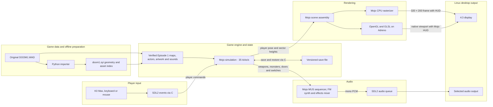

# DOOM Hangar on the UNO Q

DOOM Hangar is a single-player Mojo game for the UNO Q using id Software’s original shareware 1.9 assets. The campaign build loads Episode 1’s nine maps, simulates actors and combat at 35 ticks/s, and uses one save format for the CPU and Adreno renderers. The installed build has completed the ordinary and secret routes on the UNO Q. See the [phase plan and release playtests](../../docs/design-spec/2026-11-18-mojo-doom-campaign.md).

## Architecture

In CPU mode, Mojo draws the pixels. In GPU mode, Mojo prepares the scene and OpenGL shaders written in GLSL draw it on the Adreno. A C layer starts the program and connects Mojo to SDL2, graphics, audio and file I/O. Python prepares the asset index and runs verification tools. The installed game runs without Python.



## Play

Open **DOOM Hangar** on the UNO Q desktop for CPU rendering. Its **Play with Adreno OpenGL** desktop action selects the GPU. Both modes share the same save slot. Keyboard, mouse and the K0’s desktop numpad events are supported.

| Action | Control |
|---|---|
| Move forward / backward | W / S, Up / Down or KP8 / KP2 |
| Strafe | A / D or KP7 / KP9 |
| Turn | Relative horizontal mouse movement, Left / Right or KP4 / KP6 |
| Fire | KP5, KP1 or left click |
| Use a door or exit | Space, Enter or numpad Enter |
| Save / restore | Keypad + / − or F5 / F9 |
| Cycle owned weapons | KP3 |
| Automap / pause menu | Keypad decimal / keypad * |
| Run | Hold Shift, toggle Caps Lock, or select Auto Run in the keypad pause menu |
| Toggle controls legend | Keypad / or Tab |
| Quit and release the pointer | **Keypad 0** (including Insert), **Backspace**, ordinary 0 or Escape |

Choose **New Game → Knee-Deep in the Dead → difficulty**. New Game starts at the map’s original player position. Use KP8/KP2 to move through menus and Enter to select. The camera releases on focus loss. Click inside the window to recapture the pointer.

## Implementation and verification

The importer preserves the original actor placements and difficulty flags and prepares a separate geometry and sprite-animation index for each map. Mojo simulates alert propagation, movement, attacks, projectiles, damage, pickups, moving sectors, normal and secret exits, and save/restore. The blur spheres use the original four-frame artwork and grant temporary partial invisibility. Both renderers consume the same state. The sound mixer decodes DMX effects and sequences original MUS tracks through a two-operator synthesizer using the IWAD’s GENMIDI instrument data.

The UNO Q completed two continuous Hurt Me Plenty runs from the original player start through the Phobos Anomaly finale. The ordinary route takes the normal E1M3 exit. The secret route enters E1M9 and returns at E1M4. The verifier compares state hashes at every map entry and exit across headless, Mojo CPU rendering and Adreno rendering. Separate tests cover actor placement by skill, combat behind the first Hangar door, dropped ammunition, a mid-fight save moved between renderers and the last-Baron floor trigger. [On-board results](evidence/episode1-release.log)

Existing Hangar exploration saves have their own file. If no campaign slot exists, **Load Game** offers to import a valid legacy slot. This restores the position, ammo and doors into a fresh combat simulation. To select an older slot explicitly, run the game with `--import-hangar FILE` and use a separate `--save FILE` for the campaign.

## Original media

The user’s game-data directory on this board is `~/.local/share/switchyard/`. It holds the intact original shareware distribution, its extracted `doom1.wad`, and per-map geometry indexes. The project source contains the importer and a separate original test fixture. Use the importer’s `--inventory FILE` option to export a per-map asset and trigger inventory. A fresh checkout needs a local copy of **DOOM shareware v1.9** for Episode 1. Keep the original distribution and its accompanying notices together. [id Software shareware release listing](https://legacy.doomworld.com/idgames/idstuff/doom/doom19s) · [id Software engine source](https://github.com/id-Software/DOOM)

| File | SHA-256 |
|---|---|
| Original `doom19s.zip` | `cacf0142b31ca1af00796b4a0339e07992ac5f21bc3f81e7532fe1b5e1b486e6` |
| `doom1.wad` | `1d7d43be501e67d927e415e0b8f3e29c3bf33075e859721816f652a526cac771` |
| Prepared map indexes | Sizes and SHA-256 digests in the [build catalog](src/campaign_indexes.inc) |

To generate the nine indexes alongside a writable local copy of the WAD, run `python3 import_iwad.py /path/to/doom1.wad`. The runtime verifies the WAD and each selected map index before accessing their tables.

## Build and run

From this project directory on the Mac:

```bash
./build.sh host
./build.sh unoq
```

The build uses Mojo 1.2.0, the existing Zig 0.17.1 Linux linker and SDL2 headers. Paths default to the retained tools under `../mojo-exploration`; override `MOJO`, `ZIG` and `SDL2_INCLUDE` if needed. The executable loads the native SDL2 shared library dynamically. IWAD verification on Linux additionally uses the existing libcrypto.so.3. The ARM64 binary targets Cortex-A53 and glibc 2.34. Preserve the `build/` and `assets/` directories relative to each other.

On the UNO Q:

```bash
media=~/.local/share/switchyard
"$media/campaign-current/build/switchyard-unoq" --renderer=cpu \
    --iwad "$media/doom1.wad" --index "$media/campaign-current/data/doom1.syi" \
    --save "$media/campaign.sav"
```

Use `--map E1M1` through `--map E1M9` to select a map for verification, and `--skill 1` through `--skill 5` to set a starting difficulty outside the menu. Use `--renderer=gpu` to select the Adreno, `--windowed` for a debugging window, `--mute` for silent operation and `--resume` to open the saved game. Fullscreen fits the current desktop. CPU rendering uses a 320×200 logical buffer with 4:3 presentation. GPU world geometry draws at the actual viewport resolution. Save files are per-user files in the working directory, and `--save FILE` selects a different slot.

## Reproducible checks

Run the headless campaign checks with a matching IWAD and its generated indexes. The checks use temporary save slots.

```bash
python3 verify_campaign.py ./build/switchyard /path/to/doom1.wad
./build/switchyard --iwad /path/to/doom1.wad --index /path/to/doom1.syi --check-music
```

Add `--episode` to run both complete campaign recordings. On the UNO Q with a desktop session, add `--renderers` for CPU and Adreno comparison. Accelerated verification consumes every 35 Hz input command and renders at checkpoints, map changes and exits. Add `--performance` to run three real-time scenes with audio. The compressed fixtures contain player commands and map-entry checks. The normal game reads neither fixture during play. [Normal route](evidence/episode1-normal.trace.gz) · [Secret route](evidence/episode1-secret.trace.gz)

The original fixture and short renderer comparison remain available.

```bash
./build/switchyard --check
python3 verify.py ./build/switchyard-unoq --iwad "$media/doom1.wad" --evidence /tmp/switchyard-checks
```

The first command checks the deterministic fixture without opening a window or audio device. The second command is an on-board foreground graphics/audio trial. It runs short command traces, compares final game-state hashes and checkpoint bytes, and restores CPU saves in GPU mode and GPU saves in CPU mode. Its save slots are temporary. Reported rates count software loop iterations. Screenshot captures use PPM.

The small **Switchyard** PWAD provides an original testing room with an opening airlock, a lamp and an exit switch. Run the executable with `--fixture` to try this fixture. It has different artwork and synthetic tones. Walk toward the striped shutter, use it, pulse the relay lamp and use the marked far wall. Normal play selects the original shareware level and effects.

## Board results

The validation board ran 80,431 gameplay ticks on the ordinary route and 114,692 on the secret route. CPU and Adreno matched the headless simulation hash at every exit, including the finale. Both traces completed without a player restart. These runs measure gameplay correctness. The Military Base fight, Phobos Lab platforms and E1M6–E1M7 transition each processed all 245 input ticks. Across these real-time samples the 95th-percentile frame interval was 17–18 ms and the application audio queue stayed fed. [Verification by map and reproduction instructions](evidence/episode1-verification.md)

Desktop event tests exercised menu navigation, weapon cycling, automap, pause, save, restore and quit. Music produced nonzero samples through the board’s SDL and PipeWire path using an isolated output sink. Physical K0 and mouse feel and a listening test on the mounted speaker are pending.
