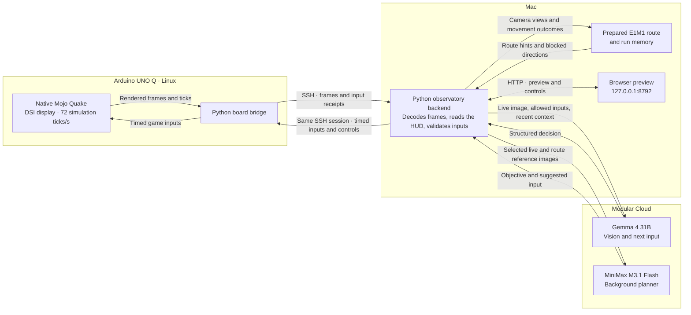
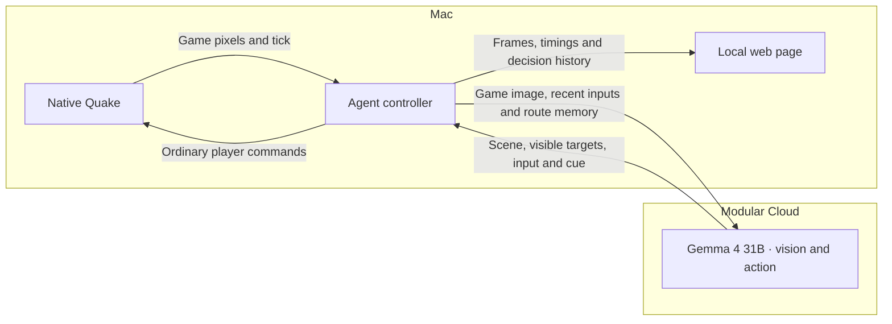

# Mojo Quake on the UNO Q

This standalone ARM64 Linux desktop game runs the original Quake shareware data on the UNO Q. The campaign target is *Dimension of the Doomed*, from the difficulty hall to the first rune. The hardware test covers both renderers. Full-route acceptance is tracked in the [phased design](../../docs/design-spec/2026-11-18-mojo-quake.md).

## Watch the agent play on a Mac

To watch the physical UNO Q, open the [UNO Q live observatory](http://127.0.0.1:8792/) on the Mac running the pilot. The [Mac game observatory](http://127.0.0.1:8790/) also links to that view.

The **Agent Observatory** runs the native Mac game in a private profile. Open its local URL and press **Play** to watch, **Single step** for one decision or **Pause** to freeze the game at the next four-tick boundary. Select a history row to see the exact frame sent to vision, estimated enemy and route markers, the local model's chosen input and the cue it selected. **Return to live** follows the game again.

The goal is to finish E1M1 by reaching its exit slipgate. The native end-of-level intermission confirms success. **Level entrance** is the default and gives the agent control at the original E1M1 spawn. **First encounter** stages the encounter by replaying 703 ordinary navigation ticks from the start map with all attack inputs removed. Control passes to the models with zero kills. **Restart** returns to the level entrance. Play continues through deaths using the agent’s own native saves. It ends at the level exit or a manual stop. Pass `--single-life` to end at the first death. Use `--limit N` for a bounded experiment.

From this project directory, build the Mac game once, then launch the default single-call controller:

```sh
./build.sh host
uv run --script agent_view/observatory.py
```

The controller uses `MODULAR_API_KEY` or an existing env file passed with `--key-file`. By default it reads the game data from `~/Library/Application Support/Mojo Quake/media/id1/pak0.pak`. Use `--media` to supply another media directory. The page listens at [127.0.0.1:8768](http://127.0.0.1:8768/). The default renderer is software. Pass `--gpu` for OpenGL.

To watch TypeSafe Jev choose inputs directly from the game camera with MiniMax M3.1 Flash as its background planner, provide `TYPESAFE_API_KEY` and `MODULAR_API_KEY` in the launch environment or pass a private key file with `--key-file`.

```sh
uv run --script agent_view/observatory.py --controller jev --planner-model minimax --port 8788
```

Open [the Jev player](http://127.0.0.1:8788/). **Jev’s view** shows the exact image submitted for a decision, the visual cue Jev selected, its proposed input and the input Quake received. Select a decision in history to inspect that moment while the game continues.

The native process sends rendered pixels over a pipe and accepts ordinary movement commands. By default Modular's Gemma 4 31B returns the observation, markers, action and cue in one request. The Mac validates the proposed input against the latest navigation constraints. The page and decision logs report the combined inference time. To run the earlier split controller, start Ollama with `gemma4:e4b-mlx` available and pass `--controller split`. In Play, the clock runs at 72 simulation ticks per second during inference and input execution. The player normally releases controls while awaiting the next decision. After a visible health loss it can strafe during inference. A committed passage test starts as soon as the turn finishes. Enemies, physics and projectiles remain active. The controller samples the world every four ticks, detects death or an exit and drops outstanding input on a manual pause or restart. Single step runs one decision cycle with the same live timing, then pauses. History shows the observation tick and the tick when input began.

The controller drops targeting or firing decisions at three seconds of age, and other inputs at eight seconds. It also drops a decision at least one second old when the sampled view has changed by 12% of the brightness range. An expired decision gets a new observation. A model request failure leaves the player idle and retries from a fresh frame during Play. The evaluator reads numeric engine state such as HP, kills and position. The models can see the HUD in the image. Every session saves its replay trace, decision log and observed frames under `build/agent-runs/`. To continue from the last completed decision after a service restart, pass `--resume-session` with that run directory. An unusable vision marker appears as **Location unclear**. The agent can still act on the scene and any valid marker. The ARM64 build implements the same frame and input protocol, so moving the game to the UNO Q can preserve this controller and browser interface.

**Jump forward** is a running jump. Vision marks a reachable landing on a low ledge or across a gap. When Gemma selects the jump, the controller aligns horizontally to that marker if present, holds forward for eight ticks of run-up, taps jump for four ticks and continues forward for another 48 ticks. The live page and recordings show the landing marker and the jump phases. Route memory evaluates the entire maneuver once after it settles.

**Height and damage.** Vision classifies the path ahead as walkable, jumpable, too low, too high or unclear. It uses the visible floor, lip and overhead space. If a proposed input is unavailable, a locally selected repositioning input is identified in the log and on screen. The native 320×240 health digits are read from the camera image with templates from the local game's HUD art. Health loss interrupts stale inference. The local response jumps backward and keeps a recent visible opponent in view, or turns to inspect behind the player when the source is unseen. Consecutive hits have a cooldown and allow one blind turn per burst. A health drop can also come from an environmental hazard.

The Mac player uses RGB camera frames. We tested an auxiliary visible-surface depth image with Gemma on E1M1. In 36 sampled views, RGB chose a viable direction or correctly called for a scan 31 times, versus 29 with depth. In 24 additional views with both open and blocked directions, RGB chose an open direction 6 times and RGB plus depth did so 10 times. The depth input remains an offline experiment. [Paired path choices, native movement probes and live trials](evidence/mac-path-depth-comparison.json)

The default cloud model is Gemma. Use `--cloud-model minimax`, `--cloud-model deepseek` or `--cloud-model qwen` to compare the other image-capable endpoints. MiniMax uses low adaptive reasoning. [Matched frame and real-time trials](evidence/mac-clearance-and-damage.json)

### Exploration memory

The Mac controller compares overlapping views using the camera angles it issued. Navigation recovery starts after 45 game seconds without sustained new views during movement. It can also trigger within a 30-second window when at least 88% of sampled moving views are familiar, with at least 12 samples spanning 20 seconds and 12 seconds since new views. It backs away, looks for an observed but untried opening and commits a short movement sequence. The observatory shows elapsed game time since new moving views and the recovery count. The detector can mistake repeated textures for a familiar area. When repeated recovery fails, the agent tests passage connections individually. It turns to a heading, walks briefly, releases the movement keys and measures outward image motion as the view settles. It keeps a local graph of crossed and blocked approaches, looks for an untested direction and can try a jump on a blocked edge. A recognizable settled view can bring it back to a previously tested junction. These connections are estimates. In two one-minute comparisons from the same later loop, the survey found zero or one new evaluator cell, versus one on the original branch. E1M1 completion remains unverified.

Vision can report a likely blocker, a marked switch, or a transport platform. The recent-action context retains those visual clues. The Mac can also check close character silhouettes between cloud calls with `--enemy-detector PATH` and a 512 × 320 YOLO11n COCO ONNX export. For this optional mode use `uv run --with onnxruntime --script agent_view/observatory.py --enemy-detector PATH`. Character tracking turns the camera in bounded increments and updates its aim from the latest game pixels. [Replay measurements and native outcomes](evidence/mac-navigation-loop-and-character-tracking.json)

The agent builds a per-run graph of places from its own camera frames and issued inputs. In **Exploration map**, green marks the current place and facing, links show traversed connections, and orange spokes mark directions with repeated unsuccessful movement. Distances are schematic. Repeated textures, moving doors and lighting changes can make different places look alike.

After a jump the controller compares the view after landing time with views facing the same direction. Two unproductive jumps at a place rule out a third jump in that direction. The decision model gets a compact summary of landmarks, previous places, failed approaches, known connections and untried directions. It can back up, strafe, turn around or level the camera to escape. The map uses game pixels and issued camera and movement inputs. The evaluator's engine coordinates stay separate. Restart builds a fresh map, and resuming a session reconstructs it from the saved inputs. A separate `traversal-skills.sqlite3` records only clearance category, input and counts of visibly changed or stalled outcomes. After three settled attempts, a compact summary can inform later runs and levels. Place IDs, images, coordinates, route sequences and exits are excluded from that transferable memory. The decision log records the memory supplied to each new model decision.

### Background planner and local player

The **Player** selector is available when the observatory is launched with `--offer-layered`. **Cloud player** uses the existing combined controller. **Local player + planner** sends reversible game-input choices to a warm Laya English 421M model on the Mac. MiniMax M3.1 Flash reviews selected RGB frames and recent outcomes on a separate worker. Switching modes keeps the level, checkpoints and decision history. From a paused run the selected controller starts on Play or Single step.

Start the local Ollaya service with its installed model cache. The following paths match the validation Mac.

```bash
OLLAYA_HOST=127.0.0.1:61375 \
OLLAYA_MODELS="$HOME/Library/Caches/mojo-quake/ollaya-0.18.0/models" \
"$HOME/Library/Caches/mojo-quake/ollaya-0.18.0/runtime/bin/ollaya" serve
```

Start the observatory with `--offer-layered` to expose both players, or `--controller layered` for the local player. The optional `--planner-model` selects the background model. `--local-player-url` selects the loopback Ollaya address. A local timeout uses a labeled fallback input.

Use `--controller layered --planner-model minimax --movement-lessons active` for the Laya player with movement feedback. When forward input leaves the view nearly stationary or two walks on one heading fail, Laya receives the evidence. A passage marker on that same blocked heading is excluded from its choices. MiniMax receives the failed attempts when it next reviews the scene. In **Decision history**, select a step and expand **Experience sent to Laya** to see the movement outcomes supplied for that decision. The run’s route map tracks places and headings. The shared traversal database records only movement types and their outcomes across runs.

### Play the visible UNO Q from the Mac

#### How the board, Mac, and models connect



The board owns the simulation clock. The Mac starts the bridge over one SSH session and uses that session in both directions. **Play** keeps the game running while the models respond. When a validated input arrives, the bridge checks its age against the source tick before applying it.

Gemma selects the next move from the current camera frame and the inputs the Mac allows for that frame. MiniMax reviews selected frames on a separate worker. The Mac can include its latest objective in a later Gemma request. The Mac also maintains the prepared route match and records which directions failed during this run.

From this project directory, build the host engine for the route reference and the ARM64 engine for the board. The Mac needs its private Quake media at `~/Library/Application Support/Mojo Quake/media`. The board needs its installed Quake media, an active Linux desktop on `:0`, and SSH access as the desktop user. Launch from the Mac with its existing `MODULAR_API_KEY` or use `--key-file` with a private env file.

```sh
./build.sh host
./prepare-sdk.sh
./build.sh unoq
uv run --script agent_view/unoq_observatory.py --stage --start closed --board arduino@tommy-uno-q.local
```

Open [UNO Q live](http://127.0.0.1:8792/) and choose **Open board game** to start paused at the level entrance in a fresh private profile. **Single step** runs one decision and pauses. The first single step asks Gemma to choose a left or right turn at the entrance. **Play** continues choosing inputs and **Close game** releases the board display. **Fire** requires a fresh sighting of a living opponent ahead and available ammunition. The dashboard shows the shell count and kill tally. [Static preview HTML](agent_view/board.html) · [Preview JavaScript](agent_view/board.js)

After closing the game, choose **First encounter** to stage the same corridor guard used in the Mac experiment. All 703 setup ticks use movement with attack released. The board verification went from 25 shells and zero kills to 23 shells and one kill through two live Gemma fire commands. [Board route and combat checks](evidence/unoq-route-and-combat.json)

**E1M1 navigation** offers two map views. **Prepared route** shows the demonstrated path and samples matched to the physical game camera. A hollow marker keeps the last confirmed landmark visible while the camera searches. **Visited places** shows a schematic graph of movement and revisits in this run. Both Gemma and MiniMax receive the matched section, the last movement outcome and failed directions. Two walks with no confirmed visual progress block that heading, including a passage marker pointing in the same direction. The map is computed on the Mac using board frames, issued camera angles and confirmed input ticks. In-game position statistics are reserved for validation.

The board runs the software renderer at 320 × 240, scales it to the 640 × 480 display and uses the desktop audio output. A local clock schedules 72 simulation ticks and nominally 60 rendered updates per second. The bridge offers indexed game frames about every four ticks over one SSH connection. It keeps one unacknowledged preview and replaces any waiting preview with the latest frame. Game ticks continue during model inference and network delays. The board checks each input's source tick, wall-clock age and finite duration, acknowledges application, and returns the native end state. A lost control heartbeat pauses the clock, and closing the SSH link releases the game.

The Mac hosts the browser, sends selected game images to Gemma 4 31B and requests objectives from MiniMax M3.1 Flash asynchronously. **Inspect source frame** shows the exact JPEG supplied for a decision. The history distinguishes model time from capture-to-input age. Browser preview age is estimated by synchronizing monotonic clocks. Decision receipts and model images are saved under `build/board-observatory`. The board-side executable and standard-library Python bridge are staged and checksum-verified under the user's cache. The desktop shortcut and player saves use the installed release and its regular profile.

Gemma chooses from a per-frame list of available inputs in a structured response. It can approach the red diamond lift button when it sees a clear path. After failed forward attempts, it can sidestep to find a new approach. The controller briefly retains the direction toward the lightning door if the camera loses its route match while leaving the lift.

On the validation board the first Gemma decision turned the camera from 90° to 122°. A further 34 applied inputs had a median frame-to-input age of 320 ms. Median browser preview age was 34 ms. The board sustained 72 ticks/s and roughly 60 render updates/s. [Board timing and display checks](evidence/unoq-live-agent.json)

### Prepared route for E1M1

With Modular Gemma selected as the decision model, choose **On-demand screenshots** under **Gemma input** to try the camera-assisted player live. At eligible decisions it checks the Quake game view about once per game second, sooner after damage, and again after an applied visual turn. **Inspect game frame** opens the observation that produced the displayed sighting. You can switch back to **Text only** during the same run.

To use Gemma 4 31B on Modular Cloud for structured gameplay decisions, add `--decision-model modular-gemma` to `--controller layered --planner-model minimax`. Gemma receives the available moves, observations, planner objective and movement experience. Decision history identifies the model used at each step, including runs that switched from Laya on resume.

Add `--e1m1-guide` to the layered player to give it a demonstrated route before it starts. On launch a separate native game replays the Normal route to intermission and builds reference views for nine sections. **Prepared route** shows the current section, the reference landmark and the suggested input. Expand **Route and optional jump** for the full itinerary and the marked tutorial takeoff and landing.

The guide compares live game pixels and issued camera angles with nearby reference views. It includes a centered approach through the first sliding door. A lost match limits the search to the surrounding part of the route. The configured decision model receives the next objective and any matched turn, passage, wait or jump. MiniMax receives the objective plus separately labeled live and reference images. When the camera loses the route, the guide keeps the last known section and withholds its movement suggestion until it recognizes a view again. The agent keeps choosing live inputs. The route follows the descending lift without jumping. A separate demonstration marks the nearby optional ledge and verifies the running jump onto it. Assisted runs record `prepared_e1m1_route` in their attempt manifest.

**Background planner** shows the source frame, reported cue, character assessment, objective, suggested input and success condition. The player keeps moving during review. **Delivered** means the objective reached an input decision. **Input matched** records the actual step that issued the suggested command. Completed objectives still require game evidence. Stale or interrupted plans retain their disposition. Plan history and decision inspection show the source tick for each recommendation. `planner.jsonl` timestamps the changes used by MP4 replay. [Live timings and replay validation](evidence/mac-planner-observatory.json)

### Camera-guided movement

The optional `--scene-model PATH` runs a monocular scene model on the Mac in a separate worker. It takes a 196 × 112 version of the RGB playing area and estimates which of three headings has more room. The local actor receives fresh estimates in its action context. Camera turns, old frames and unsuitable camera pitch invalidate the estimate. The validation Mac uses `~/Library/Caches/mojo-quake/scene-depth-anything-v2-small.onnx`. [Model export](https://huggingface.co/onnx-community/depth-anything-v2-small/blob/main/onnx/model.onnx)

After repeated short probes fail to leave a familiar area, the controller can hold forward, steer along the boundary and turn when frame-to-frame motion stalls. The `--continuous-travel` experiment enables this from the entrance. In a timed comparison from the same water-side save, sustained movement reached 45 new 64-unit cells in 175 game seconds. The original approach reached zero. This measures exploration; the native intermission or transition to E1M2 remains the completion criterion. [Camera-only trials](evidence/mac-rgb-passage-and-shore.json)

The passage graph checks architectural details in at least two compass views before marking a place as revisited. A short return walk in the private game can confirm a connection in the opposite direction. On later visits the agent can try a new angle between two earlier probes or a shorter stride to stop at a junction.

The player aims at marked controls in both axes. It can watch the marked patch after a stationary shot, remember a completed attempt and compare a touch with a shot. The lift experiment checks whether the camera keeps rising after movement is released, then tests staying aboard or stepping off. In a held-out run it detected 56 of 57 rises over 12 units, with two false positives among 150 negative examples. [Camera and movement trials](evidence/mac-visual-revisits-and-lifts.json)

A background planner can mark a visible passage, landing, button, platform or supply in its source frame. The local actor gets the corresponding input after the landmark matches the current game image. It can also investigate an isolated red marking and observe the result. The label remains a hypothesis until the game supplies evidence of its effect. The controller retains a door's visible “opens elsewhere” message across later decisions and records which control it tried.

### Own-save lookahead on the Mac

Start the observatory with `--controller layered --own-save-lookahead` to enable the experiment. The live player starts at the entrance. While it executes one short input sequence, a second native Quake process loads a temporary save made by that player. It executes the same sequence, then tests alternative walks, running jumps and interactions. The live player can respond to a visible character or health loss during the search. A mismatched camera view or an interrupted input invalidates the predicted handoff.

The search compares rendered pictures, legible HUD changes, movement of floor textures and passages the player has previously visited. It can also test whether up and down inputs move the camera, then compare swimming, diving and climbing out. For a suspected shootable control it can repeat the same approach with the trigger released and check for a visible change. MiniMax can inspect four views around the avatar and mark a passage or control. Laya on the Mac selects among the tested inputs, and the passage graph records reachable openings and visits. A marker that matches the current scene can influence the next move. The dashboard and decision history identify the selected input, source tick, comparison time and predicted views. The MP4 follows the inputs actually applied to the live game and shows the top three predicted views alongside the selected move. Level completion requires the live engine to reach intermission or E1M2.

In a 12-decision entrance test, replay reproduced the live game and produced a 15.61-second MP4. On 112 completed moves with usable floor matches, the median error in estimated horizontal travel was 29.4 Quake units. A separate scoreboard check recognized all 19 intermission frames and gave zero positives across 682 gameplay frames. [Own-save experiment](evidence/mac-own-save-lookahead.json)


### Demonstration-guided exploration

For an autonomous entrance attempt, use the layered player and own-save lookahead. The local Ollaya player and Modular background planner use their normal configuration. Add the same scene and character model paths used for camera-guided movement when launching the full perception stack.

```sh
uv run --with onnxruntime --script agent_view/observatory.py \
  --controller layered --own-save-lookahead --movement-lessons active \
  --future-passages --archive-search
```

**Movement lessons** use relative turns from human demonstrations on other maps. The fast controller can release forward input after a sustained visual stall. The planner receives the same cue. `--movement-lessons shadow` records cue matches for offline comparison. **Future passages** compares short sequences beyond the first turn. **Archive search** builds an in-memory visual graph from checkpoints created in the current attempt. Its candidate moves undergo private simulation. When the search sees a possible exit screen, it rehearses the path continuously, can request its own starting checkpoint, and checks each next move against the current camera. The game continues in real time.

Use **Level entrance** and press **Play**. The first verified native intermission from an unassisted run is the completion milestone. To audit a finished recording from a clean native game, run:

```sh
python3 verify_agent_exit.py /path/to/session-directory
```

The verifier reconstructs the saves and reloads from the input log and writes `independent-replay.json`. Its exit code is zero for a verified E1M1 exit. The observatory recording and decision log provide the accompanying evidence for how the inputs were selected.

### Native checkpoints

An entrance run starts with an empty exploration map and a fresh game profile. Its first save is at the entrance. Further saves require a distinct explored position or a visible resource gain, at least 24 game seconds between saves, and enough health and ammunition. Following a death, the agent issues Quake’s native load operation for a slot created in that run. After two failed tries from one slot it can select an earlier safe save. It remembers the attempted direction and last visible scene when inspecting the restored position. Both the dashboard and the decision log show saves and reloads. **Restart** starts a new run.

Each save is archived under `build/agent-runs/session-…/saves/agent_000001.sav` with its own numeric ID. The input trace and decision log together reproduce the run. During resume or video encoding, the player re-creates its saves at the original ticks and verifies the gameplay hash at each restore. Session ticks remain monotonic when the game world rolls back.

### First-person weapon recognition

The optional local character detector can use a weapon profile to recognize the player’s own hands and weapon on screen. The calibration tool captures pairs of views in the start hub using normal weapon display settings. During play the detector compares its candidate locations with the visible RGB artwork. The game and recording show the original weapon.

```bash
uv run --script experiments/calibrate_weapon.py --output "$HOME/Library/Caches/mojo-quake/weapon-poses.npz"
uv run --with onnxruntime --script agent_view/observatory.py \
  --enemy-detector "$HOME/Library/Caches/mojo-quake/quake-characters-yolo11n-512x320.onnx" \
  --weapon-profile "$HOME/Library/Caches/mojo-quake/weapon-poses.npz"
```

A short image-patch match can follow a detected character for up to 12 ticks through a detection gap. The HUD reader supplies current health and active ammunition and confirms centered game messages on successive frames. At zero active ammunition the agent can bypass a distant opponent and seek a visible pickup. [Mac perception and save checks](evidence/mac-character-hud-and-checkpoints.json)

The fallen-soldier regression comes from step 747 of an E1M1 entrance run. The player's view shows a prone soldier. The decision at the screenshot tick held no input, while adjacent local tracking steps aimed at the torso and pressed attack. A local pose check now releases a fully visible, wide silhouette that stays visually stable through repeated attacks. In the recorded soldier sequence it released all 22 previously retained tracking samples. It preserved all 27 tracking samples on the moving-enemy controls. Some fallen-dog detections still survived this check. The first-person weapon filter covers a different source of false detections. [Annotated input trace and acceptance criteria](evidence/mac-fallen-soldier.json)

### Replay a run

**Run recordings** holds the locally saved, seekable MP4s. A run with completed decisions is exported automatically at level completion, restart or a manual **Finish & save**. A single-life run also exports on death. Pause keeps the current run open. FFmpeg with the `libx264` encoder is required for export. The silent video follows game time, including enemy activity throughout inference. An inset shows the model's original view and the side panel shows when vision and input become available. Time spent on manual pause is omitted. Older step-based runs keep their original two-second reading holds.

The encoder replays the logged inputs locally and checks the state hash of each decision against the original run. It uses the archived model input whenever available. Encoding runs in the background. Once ready, the video can be played, scrubbed or downloaded on the page. The MP4 lives in the run directory as `agent.mp4`.



## Play

Open **Mojo Quake** for Adreno rendering. The shortcut also offers **Play with the Mojo software renderer**. Select a difficulty by walking through a hall, then enter the Episode 1 slipgate. Press **keypad 0** to quit immediately. Both renderers use the same profile.

After defeating Chthon, enter the exit beneath the arena. Press **Enter** or **fire** to advance the tally, finale text and original shareware end card. The game returns you to the start hub with your first rune.

| K0 or mouse | Action |
|---|---|
| 8 / 2, 7 / 9 | Move forward / back, strafe left / right |
| 4 / 6, 1 / decimal | Turn left / right, look up / down |
| Mouse, left button | Look and aim, fire |
| 5, Enter, 3 | Fire, jump, next weapon |
| + / − | Quicksave / quickload |
| *, 8 / 2, Enter | Open the menu, select, confirm |
| 0 | Quit |

## What runs where

Mojo reads the PAK directory, BSP collision geometry and compressed visibility rows. Both renderers use its alias-model skin, animation and triangle layout decoding. Mojo also reads and resamples PCM effects, mixes stereo sound, runs the fixed simulation clock and interprets original QuakeC v6 instructions. It encodes and validates gameplay snapshots and implements player acceleration, swept collision, software textured spans, triangle fan indices and GPU lightmap conversion. The Adreno runs GLSL for lightmapped brush surfaces. The original QuakeC program in the local PAK supplies enemy behavior, doors, weapons, triggers and campaign progression.

The program links [TyrQuake 0.71](https://github.com/RetroPie/tyrquake/tree/c0553b4ca60b608b68c133faab4f2462f7c5c195). Its C code supplies file and device I/O, model and texture loading, the local client/server protocol, QuakeC builtins, the remaining physics and rendering passes, menus, and the live state adapters for saves. Python prepares or inspects data and helps author input recordings offline. Desktop play uses the native executable, SDL2, and OpenGL for Adreno.

## Build and install

The build uses the Mojo and Zig toolchains in the sibling `mojo-exploration` project. On the development Mac it also needs SDL2 headers, Mesa headers for cross-compiling, and `bsdtar` for the original distribution. The link SDK uses libraries already present on the target.

```sh
./build.sh host
./prepare-sdk.sh
./build.sh unoq
./package.sh
```

Prepare a private media directory with `python3 prepare_shareware.py MEDIA --archive /path/to/quake106.zip` or omit the archive to fetch the original shareware distribution. On the UNO Q place the resulting directory at `~/.local/share/mojo-quake/media`. Extract `build/mojo-quake-unoq.tar.gz` to a temporary directory on the board and run its `./install-desktop.sh` as the desktop user. It installs a versioned release, a launcher, and the corresponding source archive. Saves and configuration go in `~/.local/share/mojo-quake/profile/id1`. Optional locally supplied PCM WAV soundtrack files go in `media/id1/music/track02.wav`, `track03.wav`, and so on. Game effects come from the PAK.

## Reproduce the encounter

Run from the project directory on the host, or use the installed CPU or GPU binary on the board. The recording starts in the Normal difficulty hall, enters the Slipgate Complex, fires the shotgun and finds a secret. Each row contains tick count, forward, side and vertical movement, yaw, pitch, buttons and weapon impulse. The client sends these through the ordinary movement protocol at 72 ticks per second.

```sh
MOJO_QUAKE_PROFILE=/tmp/quake-test-profile build/host/tyr-quake \
  -basedir /path/to/media -noudp -noconinput -window -width 320 -height 240 \
  -mqfast -mqreplay replays/slipgate-encounter.trace +map start
```

The board capture and map-start counts are in [hardware verification](evidence/board.md). `-mqfast` uses a fixed timestep and samples the picture once per simulated second. Frame timing comes from separately paced real-time runs.

To replay both complete routes on the board, run the following from the source directory with the desktop X11 display available. The check starts a fresh process and temporary profile for each route and renderer. It checks both electrodes and the lightning switch for each hit on Chthon, verifies the rune at the returned hub and compares every map transition.

```sh
python3 verify_campaign.py ~/.local/share/mojo-quake/current ~/.local/share/mojo-quake/media
```

## Saves and movement tests

Keypad **+** takes a version 6 snapshot and atomically replaces the quicksave after writing it. Keypad **−** validates the file and its map and QuakeC identities before switching levels. Either renderer can resume the save. The loader still accepts classic version 5 saves from the previous build. The [movement room](fixture/README.md) and [board results](evidence/board.md) cover collision, water, enemy activity and cross-renderer saves.

## Source and data

The project includes the GPL license, the source patch, and the pinned upstream archive in each local binary package. The shortcut uses TyrQuake's included icon. Keep the original game archive, PAKs and audio tracks in the private media directory. The game data has its own terms. [id Software's release notes](https://github.com/id-Software/Quake/blob/master/readme.txt)
